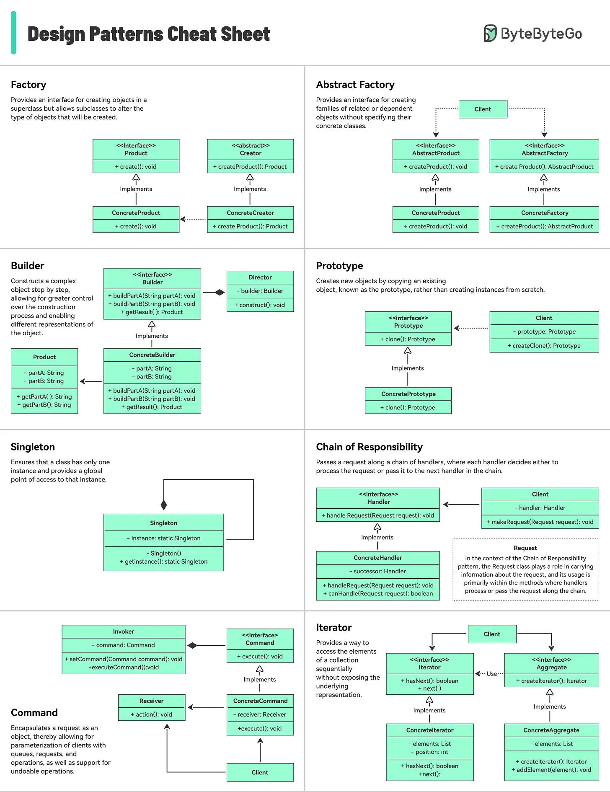
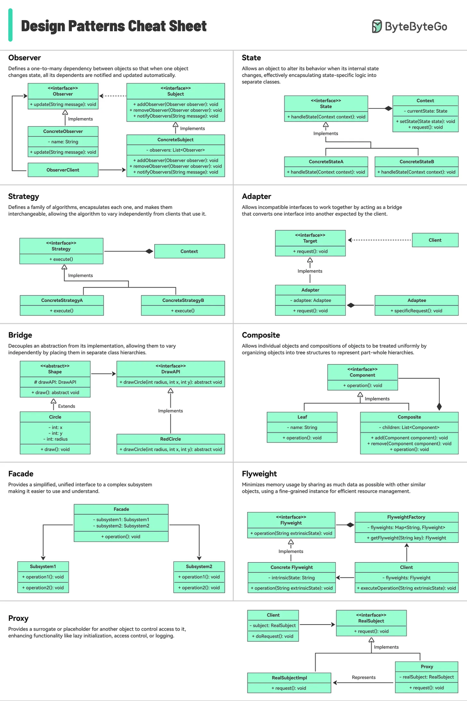

# 148 - Design Patterns Cheat Sheet

- Source: ByteByteGo Big Archive System Design 2025
- PDF pages: 305-307
- Figures: 2

## Figures

## Original Extracted Text

The cheat sheet briefly explains each pattern and how to use it.

What's included?

   ● Factory

   ● Builder

   ● Prototype

   ● Singleton

   ● Chain of Responsibility

   ● And many more!
