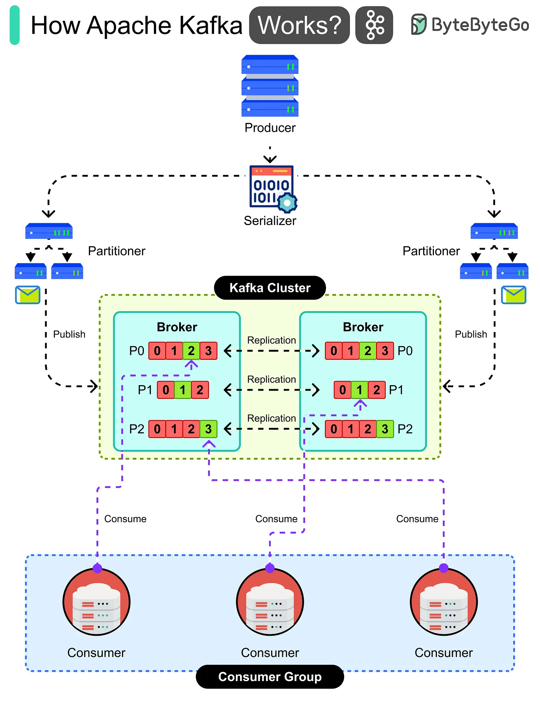

# 150 - How Apache Kafka Works?

- Source: ByteByteGo Big Archive System Design 2025
- PDF pages: 310-311
- Figures: 1

## Figures

## Original Extracted Text

Apache Kafka is a distributed event streaming platform that lets producers publish data and
consumers subscribe to it in real-time. Here's how it works:

   1. A producer application creates data, like website clicks or payment events.

   2. The data is converted by a serializer into bytes so Kafka can handle it.

3. A partitioner decides which topic partition the message should go to.

4. The message is published into a Kafka cluster made of multiple brokers.

5. Each broker stores partitions of topics and replicates them to others for safety.

6. Messages inside partitions are stored in order and available for reading.

7. A consumer group subscribes to the topic and takes responsibility for processing data.

8. Each consumer in the group reads from different partitions to balance the work.

9. Consumers process the data in real-time, such as updating dashboards or triggering actions.
