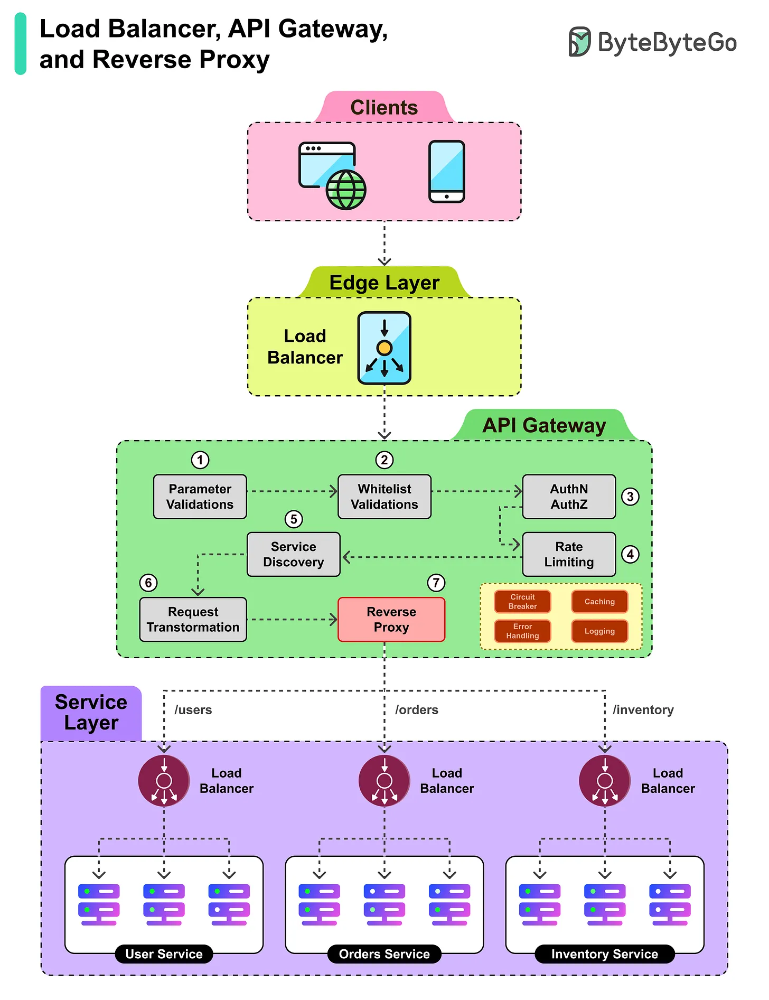

# 151 - Load Balancers vs API Gateways vs Reverse Proxy! And how can they Work Together?

- Source: ByteByteGo Big Archive System Design 2025
- PDF pages: 312-313
- Figures: 1

## Figures

## Original Extracted Text

While load balancers, API gateways, and reverse proxies often overlap each other's functionalities,
they also have specific roles that can be leveraged in a project.

   1. A client request first hits the edge load balancer, which provides a single entry point and
       distributes traffic to the API Gateway.

2. The API Gateway takes over and performs initial parameter validations to ensure the request
    is well-formed.

3. Next, the whitelist verification checks if the source is trusted and allowed to access the APIs.

4. Authentication and authorization validate the identity of the requester and their permissions.

5. Rate limiting ensures the client is not overwhelming the system with too many requests.

6. Finally, the reverse proxy inside the gateway forwards the request to the correct service
    endpoint.

7. At the service layer, another load balancer distributes the request across multiple instances
    of the target microservice.

8. The chosen service instance processes the request and returns the response to the client.
