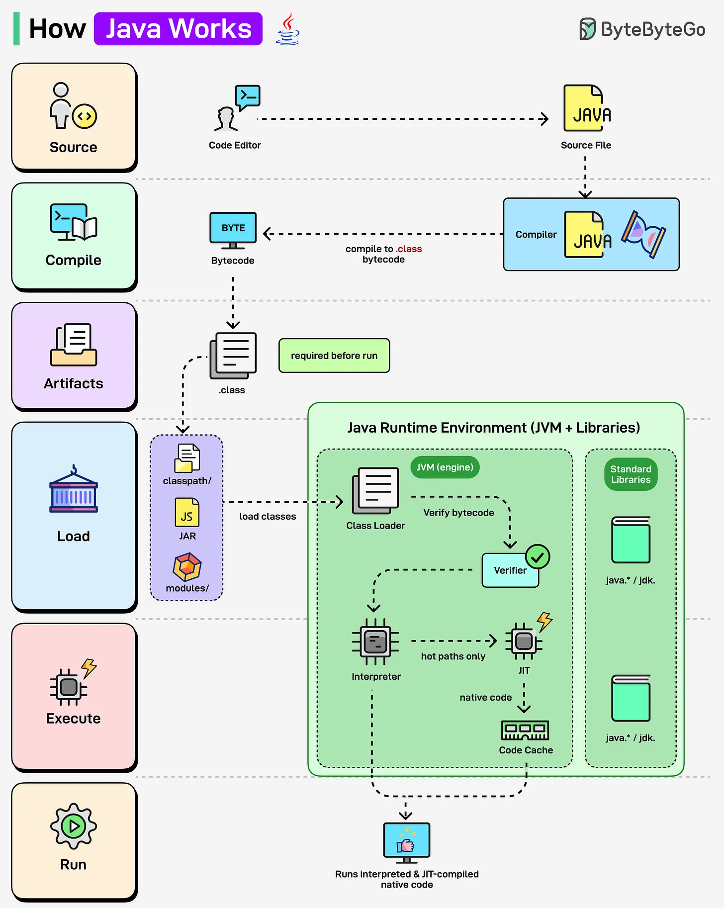

# 152 - How Java Works

- Source: ByteByteGo Big Archive System Design 2025
- PDF pages: 314-315
- Figures: 1

## Figures

## Original Extracted Text

Ever wondered what happens behind the scenes when you run a Java program? Let's find out:

Java (JVM Runtime):

   ● Java source code (.java) is compiled into .class bytecode using javac.

   ● The Class Loader loads bytecode into the Java Runtime Environment (JVM).

   ● Bytecode is verified and executed.

● JVM uses both an Interpreter and a JIT Compiler, frequently used code (hot paths) is
   converted into native machine code, making Java faster.
