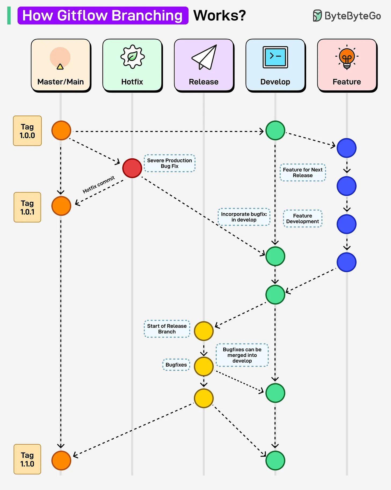

# 153 - How Gitflow Branching Works?

- Source: ByteByteGo Big Archive System Design 2025
- PDF pages: 316-317
- Figures: 1

## Figures

## Original Extracted Text

Gitflow branching strategy is a Git workflow that organizes development into dedicated branches for
features, releases, hotfixes, and the main production line. It is an ideal Git branching strategy for
projects with regular versioned deployments.

Here's how it works:

1. Development starts on the develop branch, where new features are integrated.

2. Each feature branch is created from develop and merged back once the feature is complete.

3. When preparing for a release, a release branch is created from develop for final bug fixes.

4. Release branches are merged into main (for production) and back into develop to keep a
consistent history.

5. For urgent fixes, a hotfix branch is created directly from main, then merged back into both main
and develop.
