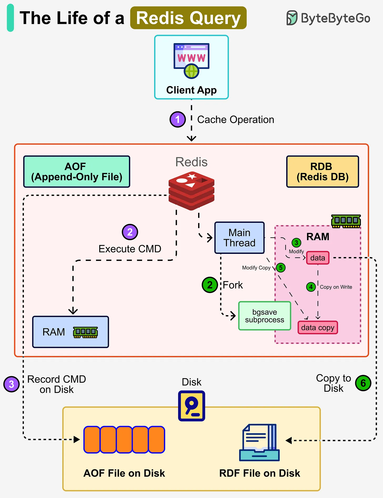

# 154 - The Life of a Redis Query

- Source: ByteByteGo Big Archive System Design 2025
- PDF pages: 318-319
- Figures: 1

## Figures

## Original Extracted Text

Redis is an in-memory database, which means all data lives in RAM for speed. However, if the
server crashes or restarts, data could be lost. To solve this problem, Redis provides two persistence
mechanisms to write data to disk:

   1. AOF (Append-Only File)
       When a client sends a command, Redis first executes it in memory (RAM). After that, Redis
       logs the command by appending it to an AOF file on disk. This ensures every operation can
       be replayed later to rebuild the dataset. Since the command is executed first and logged

   afterward, writes are non-blocking. The recovery process uses the event log to replay the
   recorded commands.

2. RDB (Redis Database)
    Instead of writing every command, Redis can periodically take snapshots of the entire
    dataset.

    The main thread forks a subprocess (bgsave) that shares all the in-memory data of the main
    thread. The bgsave subprocess reads the data from the main thread and writes it to the RDB
    file.

    Redis uses copy-on-write. When the main thread modifies data, a copy of the data is
    created, and the process works on that so that writes don't get blocked. The snapshot is then
    written as an RDB file on disk, allowing Redis to quickly reload the snapshot into memory
    when needed.

3. Mixed Approach
    In production, Redis often uses both AOF and RDB. RDB provides fast reloads with compact
    snapshots. AOF guarantees durability by recording every operation since the last snapshot.
