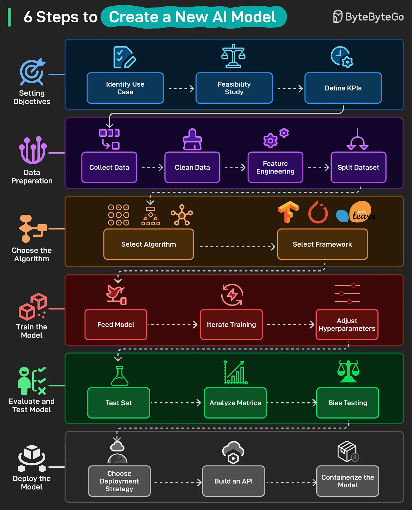

# 155 - 6 Steps to Create a New AI Model

- Source: ByteByteGo Big Archive System Design 2025
- PDF pages: 320-321
- Figures: 1

## Figures

## Original Extracted Text

1. Setting Objectives: Define the problem to be solved by the AI model by identifying use cases,
     checking feasibility, and setting clear KPIs for success.

 2. Data Preparation: Gather and clean raw data, engineer useful features, and split the data
     into training, validation, and test sets.

 3. Choose the Algorithm: Pick the right algorithm for your problem and select a framework (for
     example, TensorFlow, PyTorch, Sci-kit Learn.

 4. Train the Model: Feed data into the model, iterate training, and tune hyperparameters until
     performance improves.

5. Evaluate and Test Model: Test on unseen data, analyze performance metrics, and check for
    bias or unfair outcomes.

6. Deploy the Model: Select a deployment strategy, build an API, and containerize the model for
    production use.
