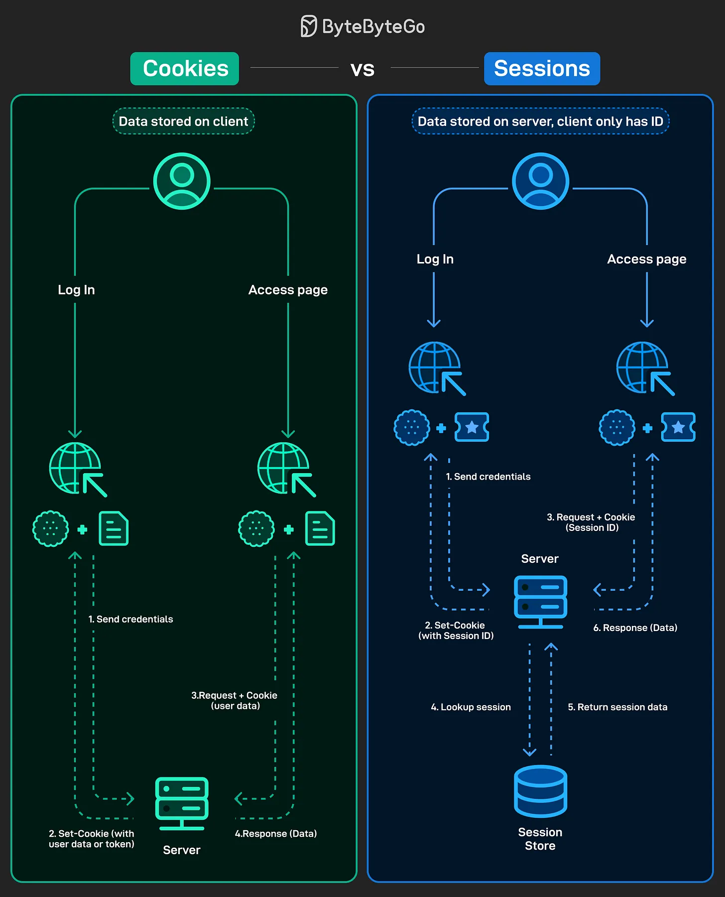

# 156 - Cookies vs Sessions

- Source: ByteByteGo Big Archive System Design 2025
- PDF pages: 322-323
- Figures: 1

## Figures

## Original Extracted Text

Every web app needs a way to remember users after they log in, and the way they manage this
makes a big difference in performance, scalability, and security of that web application.

Cookies:

   ● Store data directly on the client (like user info or tokens).

   ● Each request sends the cookie back to the server.

   ● Simpler to implement, but can expose data if not secured properly.

Sessions:

   ● Store data on the server; the client only keeps a Session ID in a cookie.

   ● Each request uses the Session ID, and the server looks up the data in its session store.

   ● More secure, but requires extra server-side storage and management.
