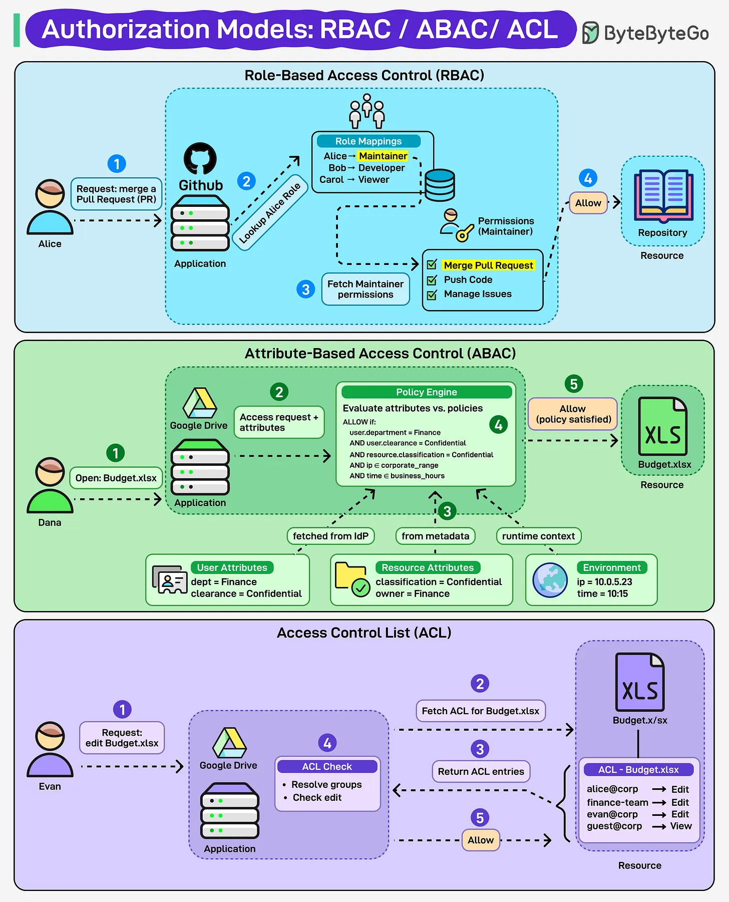

# 157 - Access Control Clearly Explained

- Source: ByteByteGo Big Archive System Design 2025
- PDF pages: 324-325
- Figures: 1

## Figures

## Original Extracted Text

Access control decides who gets in and who's locked out - but the rules vary.

   ● Role-Based Access Control (RBAC): Access based on roles (e.g., Maintainer, Viewer).
      Simple, scalable.

   ● Attribute-Based Access Control (ABAC): Access based on attributes (user, resource,
      environment). Flexible, but complex.

   ● Access Control List (ACL): Explicit permissions for each user or group. Direct, but hard to
      manage at scale.

RBAC = roles.
ABAC = attributes.
ACL = explicit permissions.
