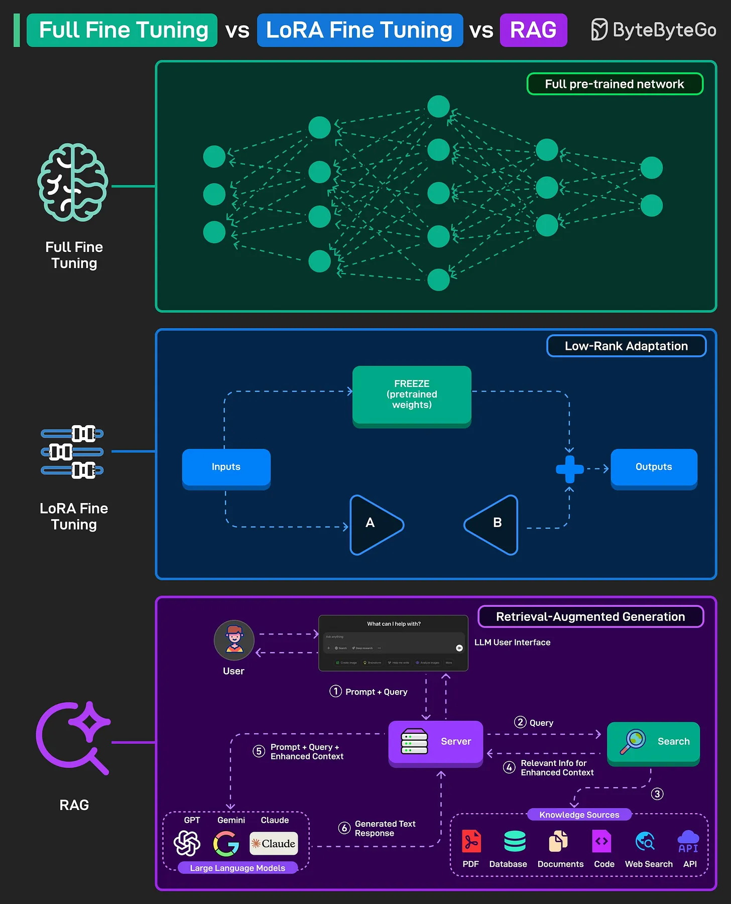

# 158 - Full Fine-Tuning vs LoRA vs RAG

- Source: ByteByteGo Big Archive System Design 2025
- PDF pages: 326-327
- Figures: 1

## Figures

## Original Extracted Text

All three are different ways of adapting a large pre-trained language model to new tasks or
knowledge.

   1. Full Fine-Tuning
       The entire pre-trained model is retrained on new data. It means that all the weights of the
       network are updated, which gives high accuracy but requires more computing power and
       storage.

   2. LoRA Fine-Tuning
       LoRA stands for Low-Rank Adaptation. Instead of changing the whole model, the main

   weights are frozen, and only small additional layers are trained. This is much faster and
   cheaper than full fine-tuning while still adapting the model to new tasks.

3. RAG
    RAG stands for retrieval-augmented generation. The model doesn't retrain. Instead, it
    retrieves information from external sources (databases, web, documents, etc) whenever
    needed. The query is enhanced with relevant context before being passed to the model,
    making it more accurate and up-to-date without heavy retraining.
