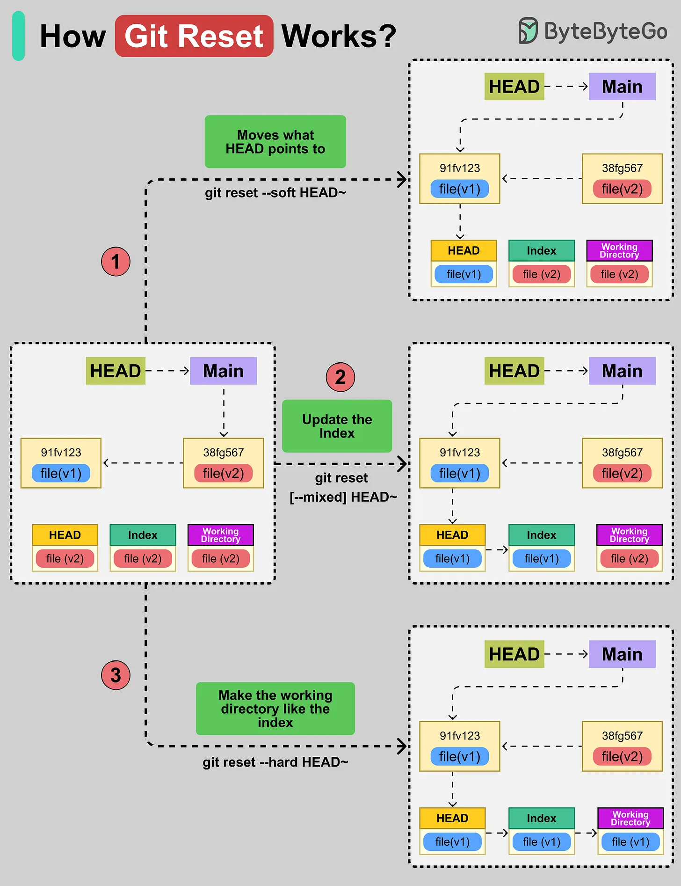

# 159 - How Git Reset Works?

- Source: ByteByteGo Big Archive System Design 2025
- PDF pages: 328-329
- Figures: 1

## Figures

## Original Extracted Text

Git Reset moves your current git branch (HEAD) to a different commit and can make the index and
working directory match it.

There are three options available with the 'git reset' command:

1. Move HEAD (--soft)
    Moves what the HEAD points to. However, the index and working files stay the same. For
    example, the 'git reset --soft HEAD~' command moves the pointer back one commit.

2. Updating the Index (--mixed)
    This is the default option. It updates the index with the contents of whatever snapshot HEAD
    now points to, but leaves your working files alone.

3. Updating the Working Directory (--hard)
    This option moves the HEAD, resets the index, and makes the working directory match that
    commit. The command 'git reset --hard HEAD~' sets everything (pointer, index, files) to the
    older commit.
