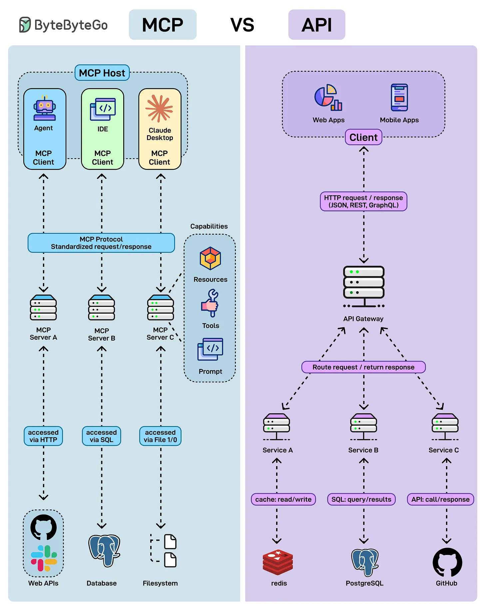

# 161 - MCP vs API: what's the difference?

- Source: ByteByteGo Big Archive System Design 2025
- PDF pages: 332-333
- Figures: 1

## Figures

## Original Extracted Text

APIs have been the backbone of software-to-software communication for decades. Now, a new
player - the Model Context Protocol (MCP) - is emerging as an AI-native protocol designed for
agents, IDEs, and LLMs.

API (Application Programming Interface):

   ● Purpose: Enables software-to-software communication.

   ● Discovery: Requires documentation.

   ● Standardization: Varies - REST, GraphQL, gRPC, etc.

MCP (Model Context Protocol):

   ● Purpose: Enables AI-native communication between clients (agents, IDEs, LLMs) and
      servers.

   ● Discovery: Self-describing (no external docs needed).

   ● Standardization: One uniform protocol for resources, tools, and prompts.
