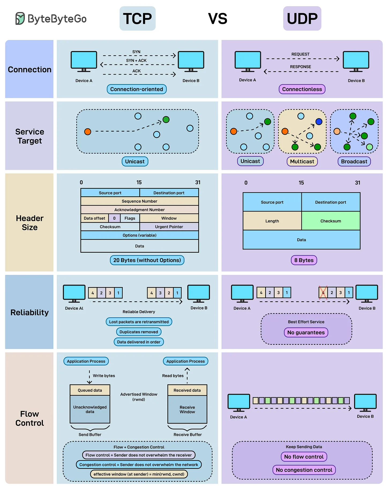

# 162 - TCP vs UDP

- Source: ByteByteGo Big Archive System Design 2025
- PDF pages: 334-334
- Figures: 1

## Figures

## Original Extracted Text

Every time data moves across the internet, it chooses between accuracy and speed. That's TCP vs
UDP.

TCP: Connection-oriented and reliable. It ensures ordered, duplicate-free delivery with flow and
congestion control, making it ideal for web browsing, email, and file transfers.

UDP: Connectionless and lightweight. It sends packets without guarantees of delivery or order, but
with minimal overhead. It is perfect for gaming, streaming, and real-time communication.
