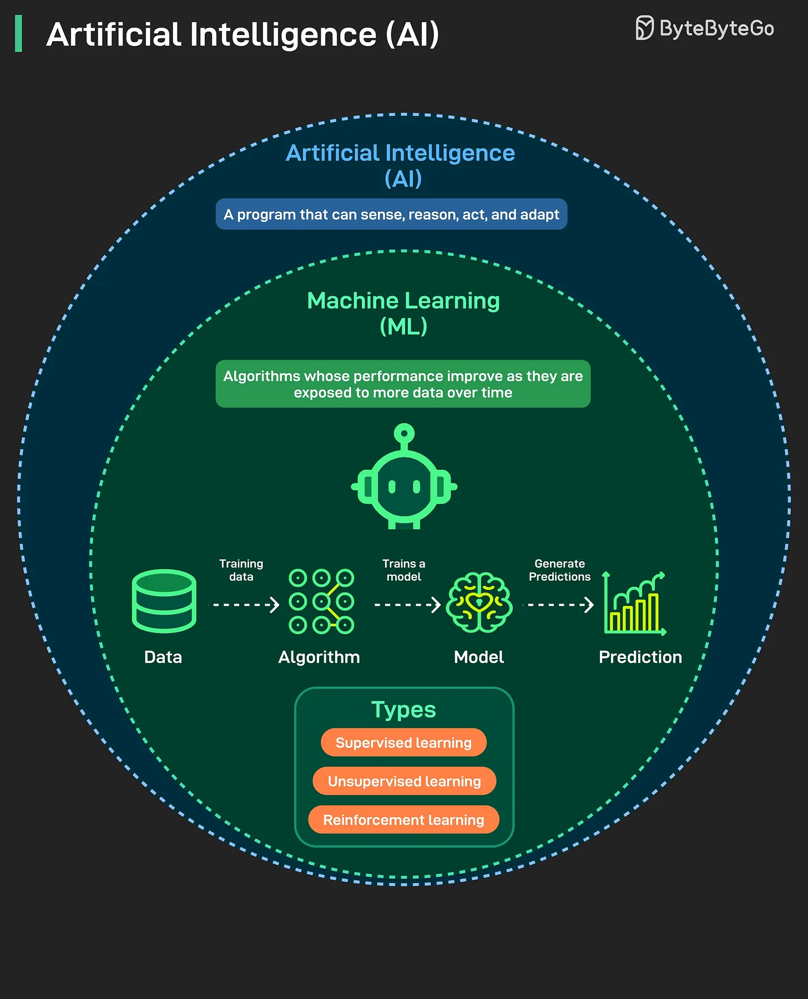

# 163 - A piece of knowledge each day: AI and Machine Learning (ML)

- Source: ByteByteGo Big Archive System Design 2025
- PDF pages: 335-336
- Figures: 1

## Figures

## Original Extracted Text

What is AI? What is ML? Are they the same thing? We will clear the common confusion in this post.

AI and ML are often treated as if they are the same thing. They are not. AI is the bigger field. It is
about creating programs that can sense, reason, act, and adapt. Any system that shows intelligent
behavior can fall under AI.

ML is a subset of AI. It focuses on algorithms that learn from data and improve with experience. This
is where most of the progress in recent years has happened. Some common use cases of ML are

recommendation engines, fraud detection, and image recognition. Most of what we interact with
daily.

The biggest breakthrough in recent years came from ML, and when the media talks about the AI
revolution, they are mostly talking about advances in ML, particularly deep learning.
