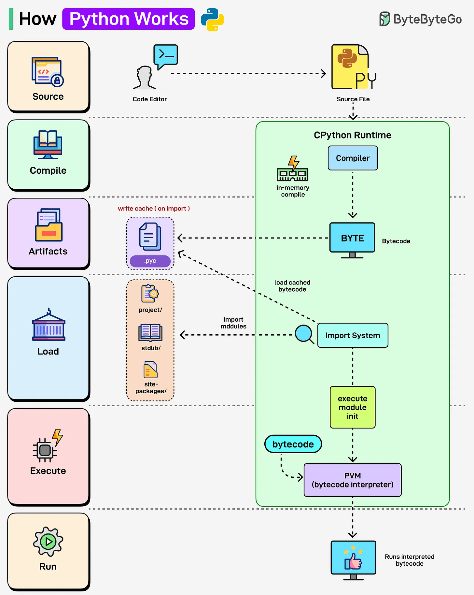

# 164 - How Python Works

- Source: ByteByteGo Big Archive System Design 2025
- PDF pages: 337-338
- Figures: 1

## Figures

## Original Extracted Text

Ever wondered what happens behind the scenes when you run a Python script? Let's find out:

Python (CPython Runtime):

   ● Python source code (.py) is compiled into bytecode automatically in memory.

   ● Bytecode can also be cached in .pyc files, making re-runs faster by using the cached
      version.

   ● The Import System loads modules and dependencies.

● The Python Virtual Machine (PVM) interprets the bytecode line by line, making Python
   flexible but relatively slower.
