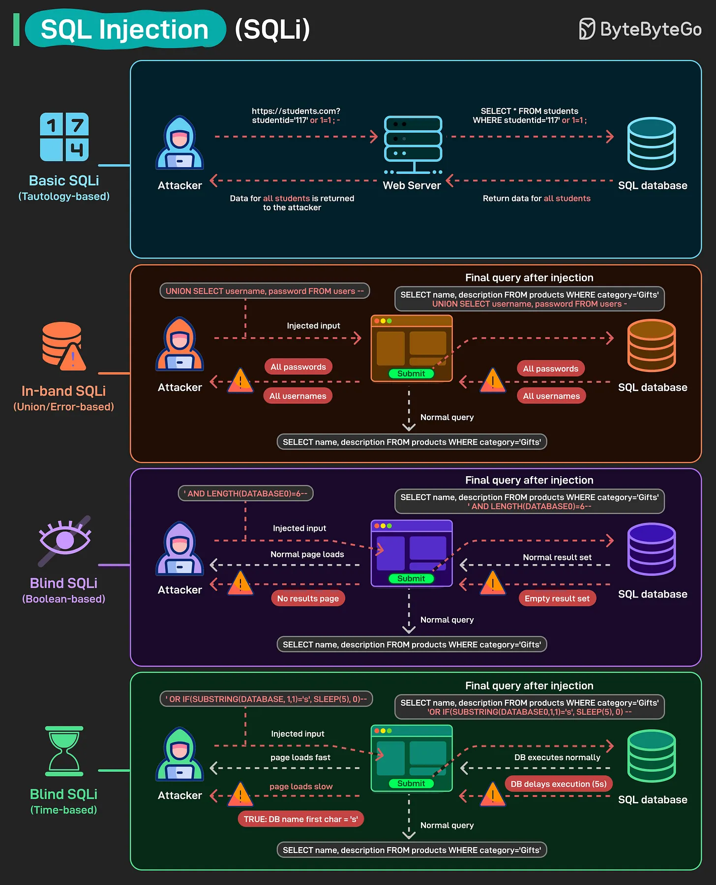

# 166 - SQL Injection (SQLi)

- Source: ByteByteGo Big Archive System Design 2025
- PDF pages: 341-342
- Figures: 1

## Figures

## Original Extracted Text

SQL Injection is one of the oldest and most dangerous web vulnerabilities. With just a few crafted
inputs, attackers can manipulate database queries and gain access to sensitive data.

Basic SQLi (Tautology-based): Attackers inject conditions like 1=1 to bypass authentication and
retrieve all records.

In-band SQLi (Union/Error-based): Attackers use UNION SELECT or leverage error messages to
extract usernames, passwords, or other sensitive data directly.

Blind SQLi (Boolean-based): No direct output is shown, but attackers infer database information
based on whether a page returns results or not.

Blind SQLi (Time-based): Attackers use commands like SLEEP(5) to measure server response
delays and extract data incrementally.
