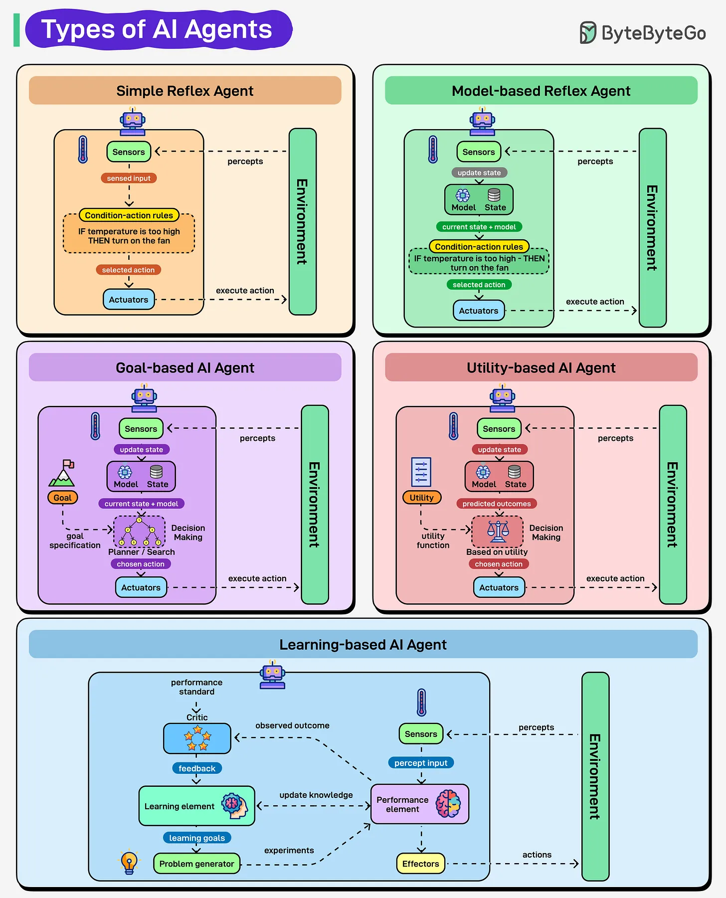

# 167 - Types of AI Agents

- Source: ByteByteGo Big Archive System Design 2025
- PDF pages: 343-344
- Figures: 1

## Figures

## Original Extracted Text

AI agents don't all think and act in the same way. They range from simple rule-followers to systems
that learn and adapt. Each type marks a step forward in how machines perceive, decide, and act.

   1. Simple Reflex Agents: These follow condition-action rules. For example, if the temperature
       is high, turn on the fan. No memory, no thinking, just instant reaction. They are fast and
       simple.

   2. Model-based Reflex Agents: These maintain an internal understanding of their environment.
       They are not just reacting to immediate inputs, they have a model that helps them make
       sense of what is happening beyond what they can see right now.

3. Goal-based Agents: Here, the focus shifts to goals. Decisions are made based on whether
    an action brings the agent closer to its objective.

4. Utility-based Agents: These go a step further by weighing different outcomes. They choose
    the action that offers the best overall result, balancing trade-offs along the way.

5. Learning Agents: These are the most advanced. They improve continuously, using feedback
    to adapt and perform better over time.
