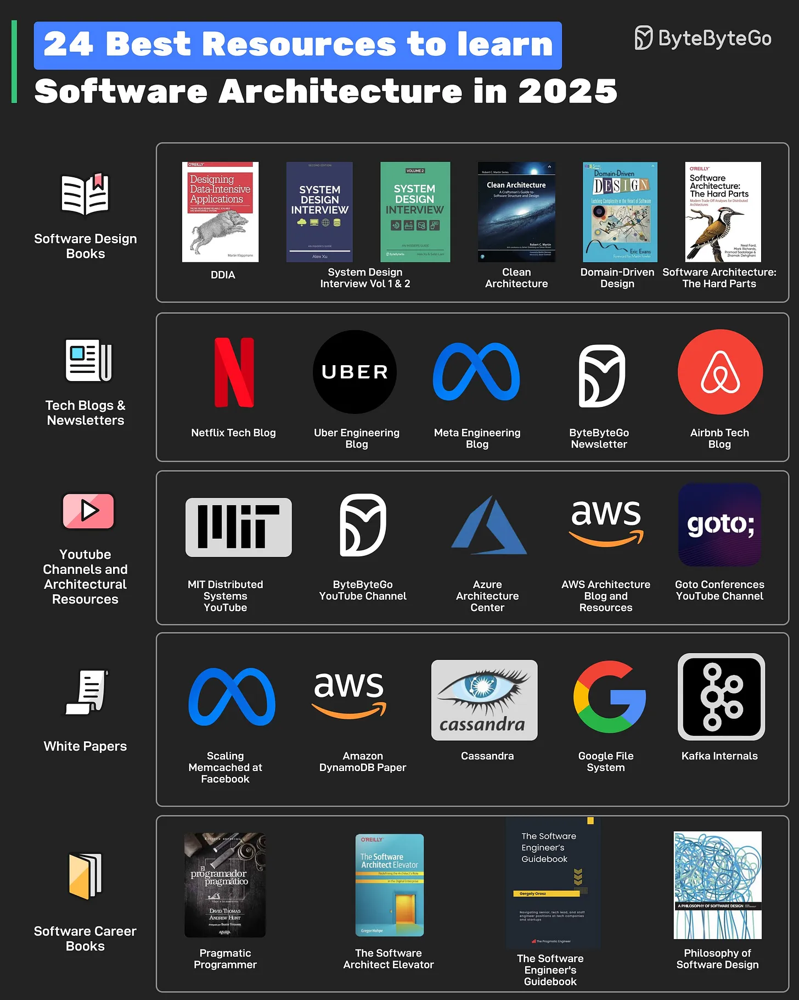

# 168 - 24 Good Resources to Learn Software Architecture in 2025

- Source: ByteByteGo Big Archive System Design 2025
- PDF pages: 345-346
- Figures: 1

## Figures

## Original Extracted Text

The resources can be divided into different types such as:

   1. Software Design Books
       Some books that can help are DDIA, System Design Volume 1 & 2, Clean Architecture,
       Domain-Driven Design, and Software Architecture: the Hard Parts

2. Tech Blogs and Newsletters
    Read technical blogs by companies like Netflix, Uber, Meta, and Airbnb. Also, the
    ByteByteGo newsletter provides insights into software design every week.

3. YouTube Channels and Architectural Resources
    YouTube channels like MIT Distributed Systems, Goto Conferences, and ByteByteGo can
    help with software architecture and system design. Azure Architecture Center and AWS
    Architecture Blog are other important resources.

4. WhitePapers
    For deeper insights, read whitepapers like Facebook Memcache Scaling, Cassandra,
    Amazon DynamoDB, Kafka, and Google File System.

5. Software Career Books
    A Software Architect also needs to develop holistic skills. Books about software career
    aspects such as Pragmatic Programmer, The Software Architect Elevator, The Software
    Engineer's Guidebook, and Philosophy of Software Design can help.
