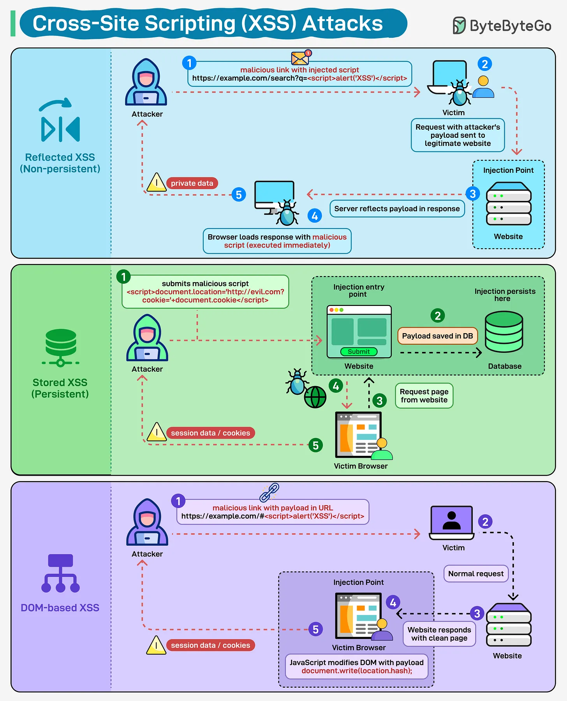

# 169 - Cross-Site Scripting (XSS) Attacks

- Source: ByteByteGo Big Archive System Design 2025
- PDF pages: 347-348
- Figures: 1

## Figures

## Original Extracted Text

A small script can cause big damage. XSS lets attackers inject malicious code into web pages and
hijack user sessions, steal cookies, or manipulate the browser.

Reflected XSS: This type of attack happens when someone clicks a malicious link. The payload sits
in the URL, gets reflected back in the response, and executes. It's often used in phishing campaigns
because you need to trick someone into clicking.

Stored XSS: The malicious code gets saved in your database, maybe in a comment field or user
profile. Then it runs automatically every time someone loads that page.

DOM-based XSS: The payload manipulates the DOM directly in the browser without ever hitting your
server. Makes it harder to catch with traditional server-side validation.
