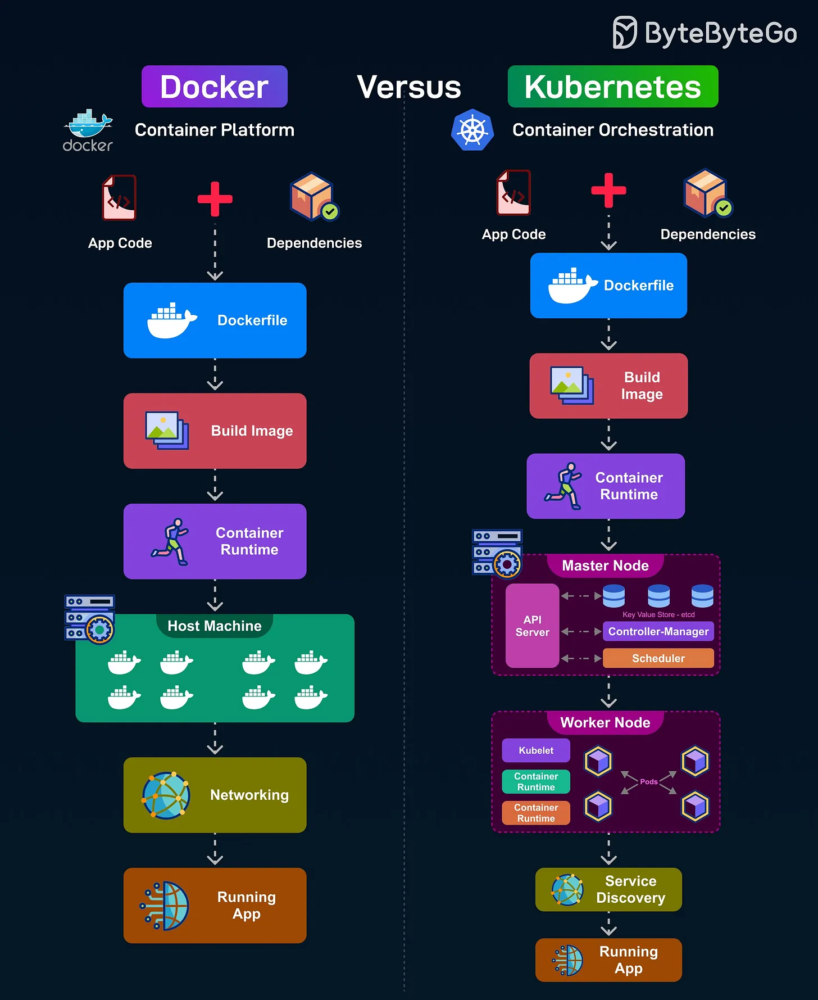

# 170 - Docker vs Kubernetes

- Source: ByteByteGo Big Archive System Design 2025
- PDF pages: 349-350
- Figures: 1

## Figures

## Original Extracted Text

Docker is a container platform that lets you package applications with their dependencies and run
them on a single machine. Here's how it works:

   1. Starts with the app code and dependencies written into a Dockerfile.

   2. The build image step creates a portable container image.

   3. A container runtime runs the image directly on the host machine.

   4. Networking connects containers and external services and produces the final running app.

Kubernetes is a container orchestration platform that manages containerized applications across a
cluster of machines for scalability and resilience. Here's how it works:

   1. Starts with the app code and dependencies in a Dockerfile.

   2. The build image is passed to a container runtime supported by Kubernetes.

   3. A master node runs the API server, etcd (key-value store), controller manager, and scheduler
       to coordinate the cluster.

   4. Worker nodes run the actual containers inside the Pods, managed by Kubelet and
       kube-proxy for networking.

   5. Produces a running app that is distributed, scalable, and self-healing in nature.
