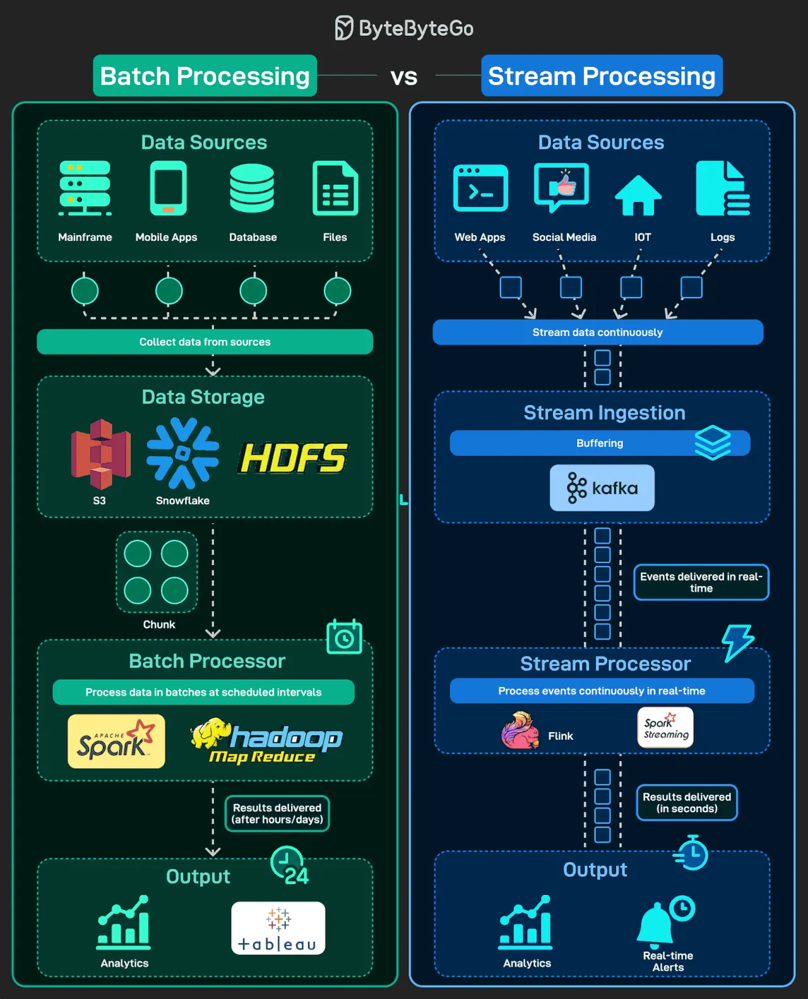

# 171 - Batch vs Stream Processing

- Source: ByteByteGo Big Archive System Design 2025
- PDF pages: 351-352
- Figures: 1

## Figures

## Original Extracted Text

Data never stops flowing, but how we process it makes all the difference. When building data
systems, two main approaches emerge: batch processing and stream processing. Both have their
place, depending on whether you need accuracy over time or immediate insights.

Batch Processing: Collects data in chunks and processes it at scheduled intervals, great for reports
and historical analysis.

Stream Processing: Processes events continuously in real-time, powering dashboards, alerts, and
recommendations.

Batch = high-volume, historical accuracy.
Stream = low-latency, real-time action.
