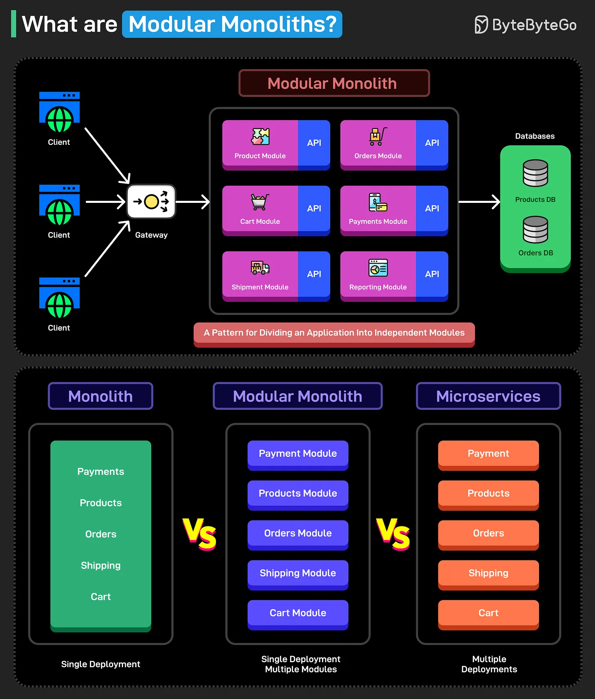

# 172 - What are Modular Monoliths?

- Source: ByteByteGo Big Archive System Design 2025
- PDF pages: 353-354
- Figures: 1

## Figures

## Original Extracted Text

A modular monolith is an architectural pattern that divides an application into independent modules
or components. Each of these modules has well-defined boundaries that group related
functionalities. Doing so results in better cohesion.

Here are the main characteristics of modular monoliths:

   1. The modules are independent.

   2. Each module provides a specific functionality.

   3. Each module should expose a well-defined interface.

What is the main advantage of modular monoliths?

A monolith clubs all the functionalities into one big deployment unit. This makes monoliths simple to
understand.

Microservices distribute the functionalities into separate deployable units. This makes them more
scalable.

However, A modular monolith divides the application into modules that are part of the same
deployment unit. They combine the simplicity of traditional monolithic applications with the flexibility
of microservices.

In other words, you can have the best of both worlds with modular monoliths.

So - have you used modular monoliths to build applications?
