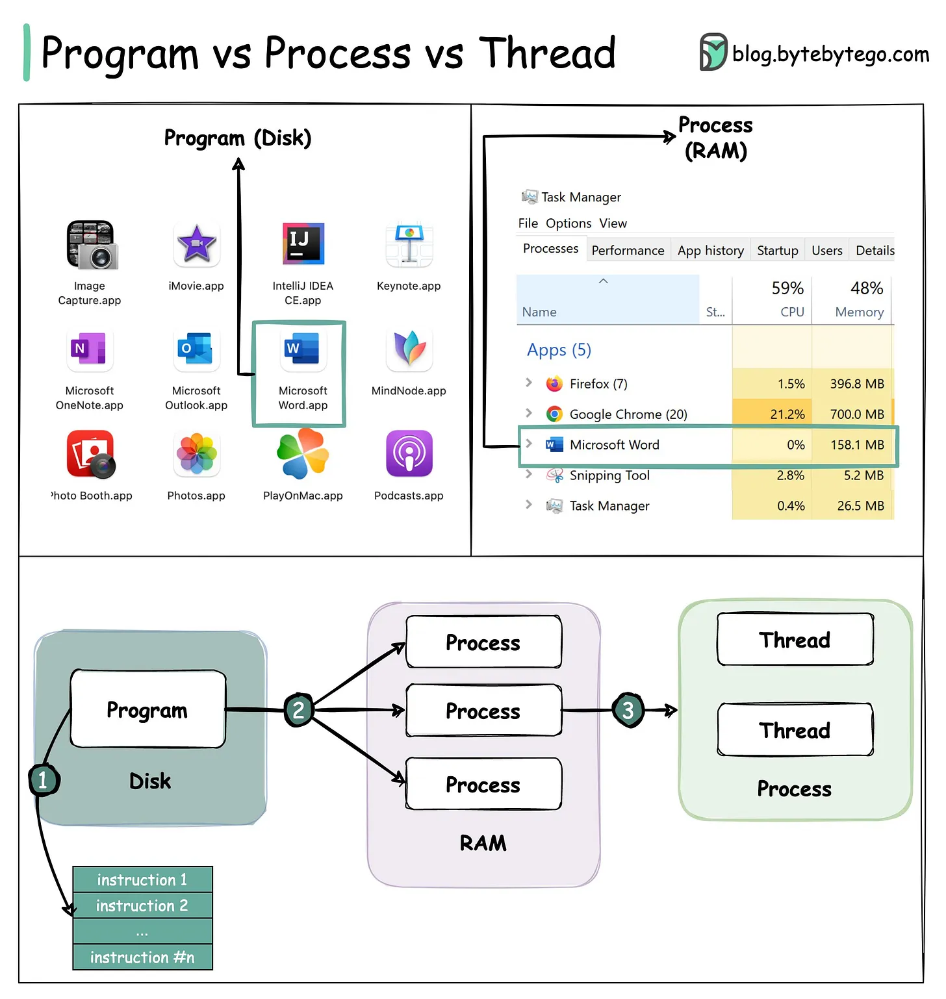

# 173 - Popular interview question: What is the difference between Process and Thread?

- Source: ByteByteGo Big Archive System Design 2025
- PDF pages: 355-355
- Figures: 1

## Figures

## Original Extracted Text

Main differences between process and thread:

   ● Processes are usually independent, while threads exist as process subsets.

   ● Each process has its own memory space. Threads that belong to the same process share
      the same memory.

   ● A process is a heavyweight operation. It takes more time to create and terminate.

   ● Context switching is more expensive between processes.

   ● Inter-thread communication is faster for threads.
