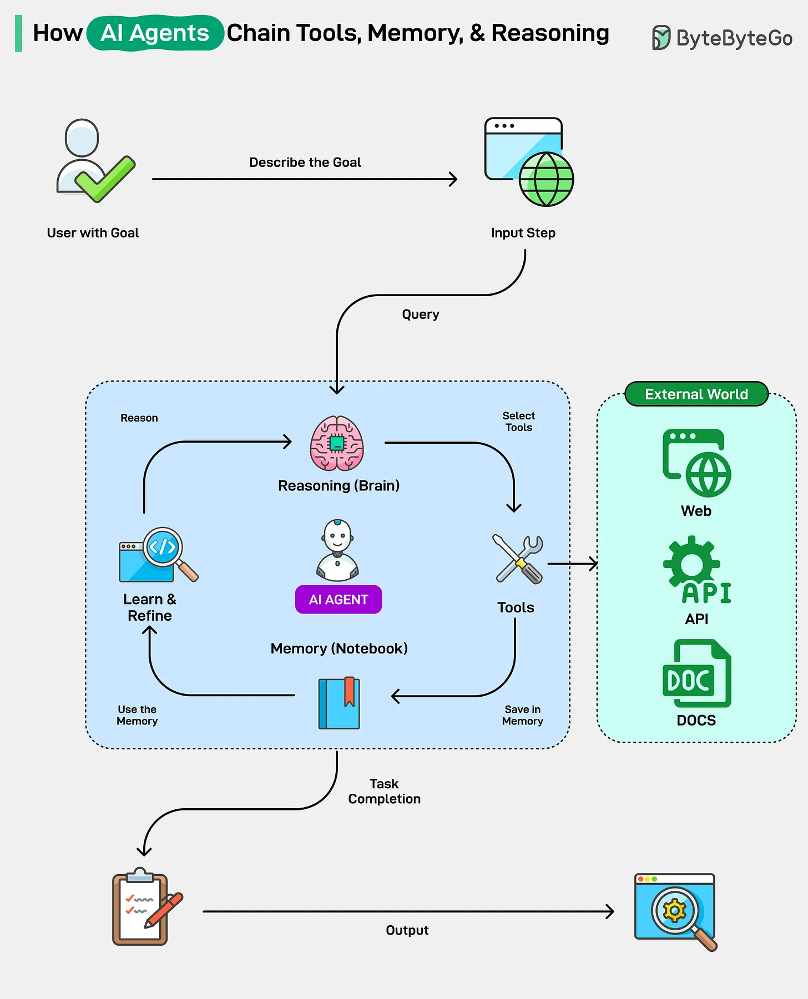

# 174 - How AI Agents Chain Tools, Memory, and Reasoning?

- Source: ByteByteGo Big Archive System Design 2025
- PDF pages: 356-357
- Figures: 1

## Figures

## Original Extracted Text

1. Reasoning: This is the brain of the AI agent. It receives the user's goal as a query and uses
     its reasoning agent (using frameworks like ReAct) to break the goal into a series of smaller,
     logical steps.

 2. Tools: For each step, the agent selects an appropriate tool. These can be external programs
     or APIs that it can call upon, such as a web search, a calculator, a code interpreter, or
     documents.

    3. Memory: This is like the notebook. The agent records the outcome of each tool's use in its
        memory. This notebook allows it to learn from results, maintain context over long
        conversations, and refine its plan based on new findings.

This continuous loop of reasoning, acting with a tool, and remembering the outcomes creates a
chain. Finally, when the agent is satisfied that it has fulfilled the user's query, it responds to the user.
