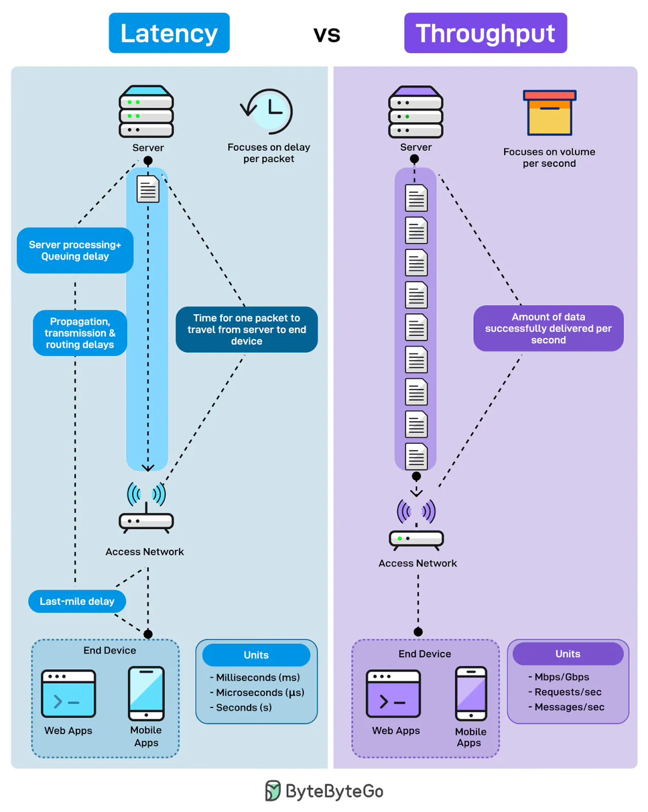

# 175 - Latency vs. Throughput

- Source: ByteByteGo Big Archive System Design 2025
- PDF pages: 358-359
- Figures: 1

## Figures

## Original Extracted Text

Ever wondered why your app feels slow even when the bandwidth looks fine? Latency and
throughput explain two very different stories of performance.

Latency measures the delay per packet. It is what users feel when they click a button. It's
responsiveness. It is the time for one request to travel from the server to the end device. This
includes server processing time, queuing delays, propagation through the network, transmission
delays, and the last-mile connection to the user's device.

Throughput measures volume per second. It is how much data successfully gets delivered in a given
timeframe. Not how fast each packet moves, but how many packets flow through the pipe.

Throughput is capacity. High throughput means the system handles the load without choking.
