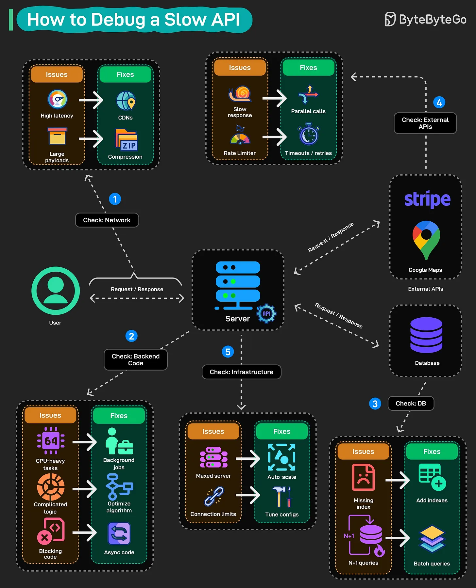

# 177 - How to Debug a Slow API?

- Source: ByteByteGo Big Archive System Design 2025
- PDF pages: 362-363
- Figures: 1

## Figures

## Original Extracted Text

Your API is slow. Users are complaining. And you have no idea where to start looking. Here is the
systematic approach to track down what is killing your API.

Start with the network: High latency? Throw a CDN in front of your static assets. Large payloads?
Compress your responses. These are quick wins that don't require touching code.

Check your backend code next: This is where most slowdowns hide. CPU-heavy operations should
run in the background. Complicated business logic that needs simplification. Blocking synchronous
calls that should be async. Profile it, find the hot paths, fix them.

Check the database: Missing indexes are the classic culprit. Also watch for N+1 queries, where you
are hammering the database hundreds of times when one batch query would do.

Don't forget external APIs: That Stripe call, that Google Maps request, they are outside your control.
Make parallel calls where you can. Set aggressive timeouts and retries so one slow third-party
doesn't tank your whole response.

Finally, check your infrastructure: Maxed-out servers need auto-scaling. Connection pool limits need
tuning. Sometimes the problem isn't your code at all, it's that you are trying to serve 10,000 requests
with resources built for 100.

The key is being methodical. Don't just throw solutions at the wall. Measure first, identify the actual
bottleneck, then fix it.
