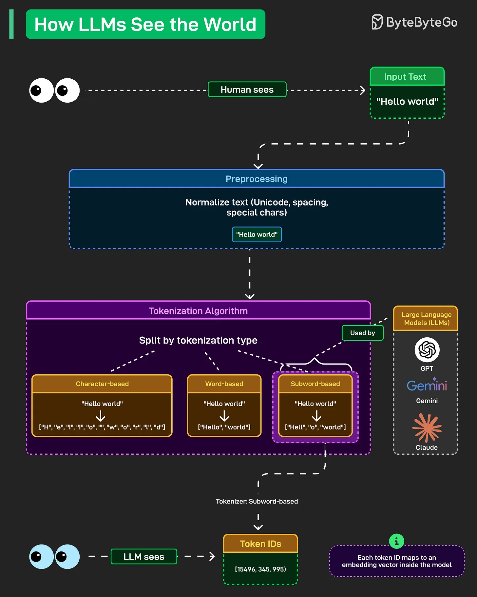

# 178 - How LLMs See the World

- Source: ByteByteGo Big Archive System Design 2025
- PDF pages: 364-365
- Figures: 1

## Figures

## Original Extracted Text

When you type "Hello world" into ChatGPT or Claude, the model isn't processing those letters and
spaces like you're reading this post right now. It's converting everything into numbers through a
process most people never think about.

Preprocessing comes first. Text gets normalized. Unicode characters, spacing quirks, and special
symbols, they all get cleaned up and standardized. "Hello world" becomes a consistent format that
the model can actually work with.

Then comes tokenization. This is where things get interesting. The model splits text into tokens, and
there are different approaches.

   1. Character-based tokenization breaks everything down to individual characters. "Hello world"
       becomes ["H", "e", "l", "l", "o", " ", "w", "o", "r", "l", "d"]. Simple but inefficient.

   2. Word-based splits on whole words. ["Hello", "world"]. Cleaner but struggles with rare words
       and creates massive vocabularies.

   3. Subword-based is what modern LLMs actually use. GPT, Gemini, Claude, they all rely on
       this. "Hello world" becomes something like ["Hell", "o", "world"]. It balances efficiency with
       flexibility, handling rare words by breaking them into known subword pieces.

The final step is Token IDs. Those subwords get mapped to numbers like [15496, 345, 995]. Each
token ID corresponds to an embedding vector inside the model. That's what the neural network
actually processes.
