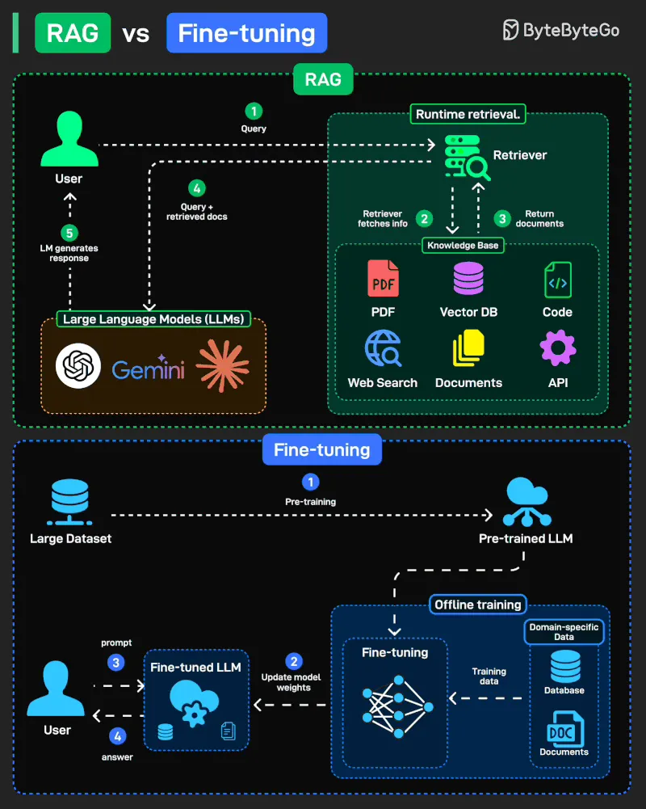
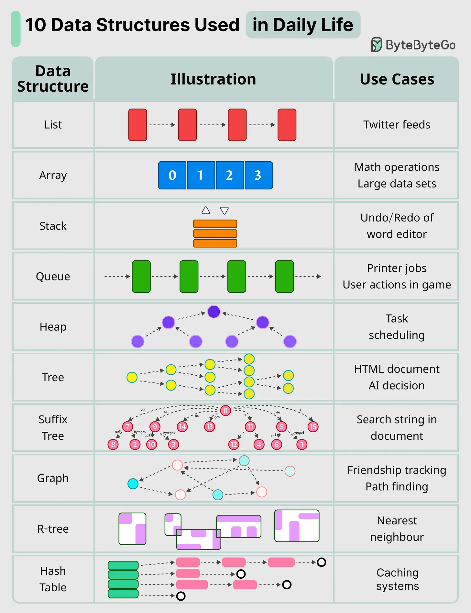

# 179 - RAG vs Fine-tuning: Which one should you use?

- Source: ByteByteGo Big Archive System Design 2025
- PDF pages: 366-368
- Figures: 2

## Figures

## Original Extracted Text

When it comes to adapting Large Language Models (LLMs) to new tasks, two popular approaches
stand out: Retrieval-Augmented Generation (RAG) and Fine-tuning. They solve the same problem,
making models more useful, but in very different ways.

RAG (Retrieval-Augmented Generation): Fetches knowledge at runtime from external sources (docs,
DBs, APIs). Flexible, always fresh.

Fine-tuning: Offline training that updates model weights with domain-specific data, making the model
an expert in your field.

10 Key Data Structures We Use Every Day

 ● list: keep your Twitter feeds

 ● stack: support undo/redo of the word editor

 ● queue: keep printer jobs, or send user actions in-game

 ● hash table: cashing systems

 ● Array: math operations

● heap: task scheduling

● tree: keep the HTML document, or for AI decision

● suffix tree: for searching string in a document

● graph: for tracking friendship, or path finding

● r-tree: for finding the nearest neighbor

● vertex buffer: for sending data to GPU for rendering
