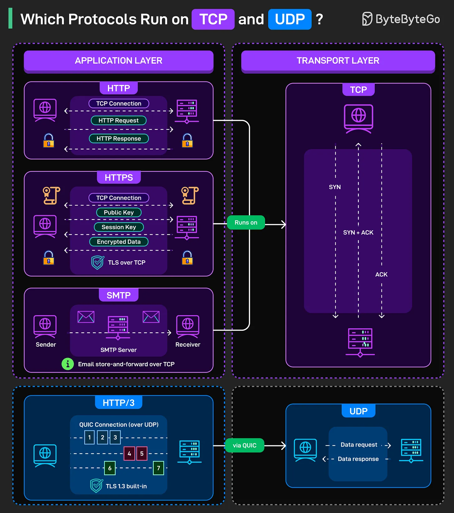

# 181 - Which Protocols Run on TCP and UDP

- Source: ByteByteGo Big Archive System Design 2025
- PDF pages: 371-372
- Figures: 1

## Figures

## Original Extracted Text

Every message sent over the internet has two layers of communication, one that carries the data
(transport) and one that defines what the data means (application). TCP and UDP sit at the transport
layer, but they serve completely different purposes.

TCP is connection-oriented. It guarantees delivery, maintains order, and handles retransmission
when packets get lost.

   ● HTTP runs on TCP. The browser opens a TCP connection, sends an HTTP request, waits for
      the HTTP response, and closes the connection (or keeps it alive for subsequent requests).
      Every web page you have ever loaded used this pattern.

   ● HTTPS adds TLS over TCP. The TCP connection happens first. Then comes the TLS
      handshake with public key exchange, session key negotiation, and finally encrypted data
      transfer.

   ● SMTP uses TCP for email. Messages flow from sender to SMTP server to receiver over TCP
      connections. Email can't afford to lose data mid-transmission, so TCP's reliability is
      essential.

UDP is connectionless. No handshake. No guaranteed delivery. No order preservation. Just fire data
requests and responses into the network and hope they arrive. Sounds chaotic, but it's fast.

   ● HTTP/3 runs over QUIC, which uses UDP. This seems backwards until you realize QUIC
      reimplements the reliability features of TCP inside UDP, but with better performance. Multiple
      streams over one connection. Built-in TLS 1.3. Faster connection establishment. The
      numbered streams in the diagram show parallel data flows that don't block each other.
