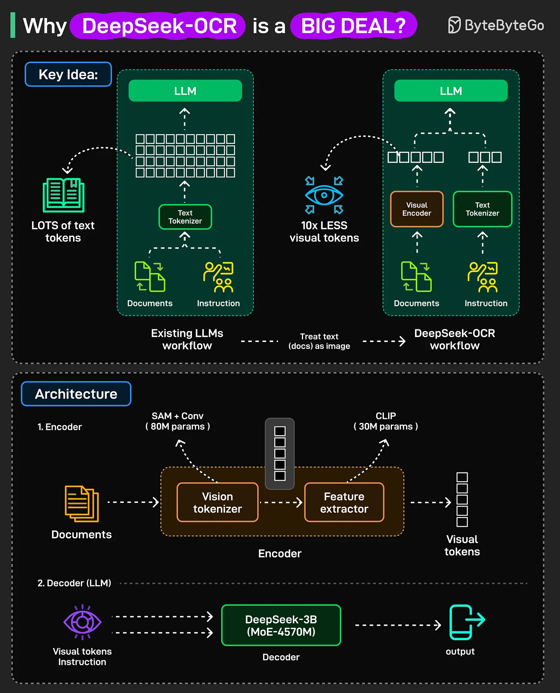

# 182 - Why is DeepSeek-OCR such a BIG DEAL?

- Source: ByteByteGo Big Archive System Design 2025
- PDF pages: 373-374
- Figures: 1

## Figures

## Original Extracted Text

Existing LLMs struggle with long inputs because they can only handle a fixed number of tokens,
known as the context window, and attention cost grows quickly as inputs get longer.

DeepSeek-OCR takes a new approach.

Instead of sending long context directly to an LLM, it turns it into an image, compresses that image
into visual tokens, and then passes those tokens to the LLM.

Fewer tokens lead to lower computational cost from attention and a larger effective context window.
This makes chatbots and document models more capable and efficient.

How is DeepSeek-OCR built? The system has two main parts:

   1. Encoder: It processes an image of text, extracts the visual features, and compresses them
       into a small number of vision tokens.

   2. Decoder: A Mixture of Experts language model that reads those tokens and generate text
       one token at a time, similar to a standard decoder-only transformer.

When to use it?

DeepSeek-OCR shows that text can be efficiently compressed using visual representations.

It is especially useful for handling very long documents that exceed standard context limits. You can
use it for context compression, standard OCR tasks, or deep parsing, such as converting tables and
complex layouts into text.
