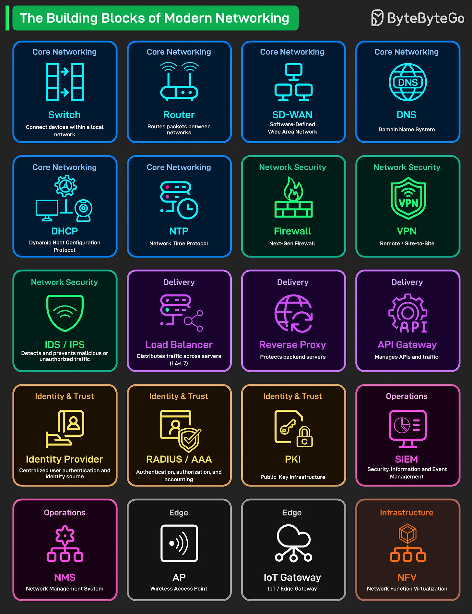

# 184 - The Building Blocks of Modern Networking

- Source: ByteByteGo Big Archive System Design 2025
- PDF pages: 376-377
- Figures: 1

## Figures

## Original Extracted Text

Every modern network, from home Wi-Fi to global cloud infrastructure, is built on a few essential
components. Here's a quick overview of the Building Blocks of Modern

Networking:

   ● Core Networking: Switches connect devices within a local network. Every office has dozens
      of these. Routers move packets between different networks. Your gateway to the internet
      and beyond. SD-WAN is how modern companies connect branch offices. Software-defined,

    flexible, way cheaper.
    DNS translates domain names to IP addresses. DHCP hands out IP addresses
    automatically. NTP keeps clocks synchronized across all systems.

● Network Security: Firewalls are your first line of defense. Next-gen versions can inspect
   traffic at the application level. VPNs create encrypted tunnels for remote access and
   site-to-site connections. Remote work runs on this. IDS/IPS detects and blocks malicious
   traffic before it reaches your servers.

● Delivery (Traffic management): Load Balancers distribute requests across multiple servers.
   One server goes down? Users never notice. Reverse Proxy sits in front of your backend
   servers, handling SSL termination and caching. API Gateway manages all your API traffic.

● Identity & Trust: Identity Provider is your single source of truth for user authentication. Think
   Okta, Azure AD, Auth0. RADIUS/AAA handles network device authentication. PKI manages
   digital certificates and encryption keys. HTTPS wouldn't exist without it.

● Operations: SIEM collects and analyzes security events from across your entire
   infrastructure. NMS monitors network health and performance. Alerts you before users start
   complaining.

● Edge: Access Points provide WiFi coverage. IoT Gateway connects sensors, cameras, and
   smart devices to your network. The bridge between operational tech and IT.

● Infrastructure: NFV runs network functions as software instead of dedicated hardware.
   Virtual firewalls, virtual routers, virtual everything.
