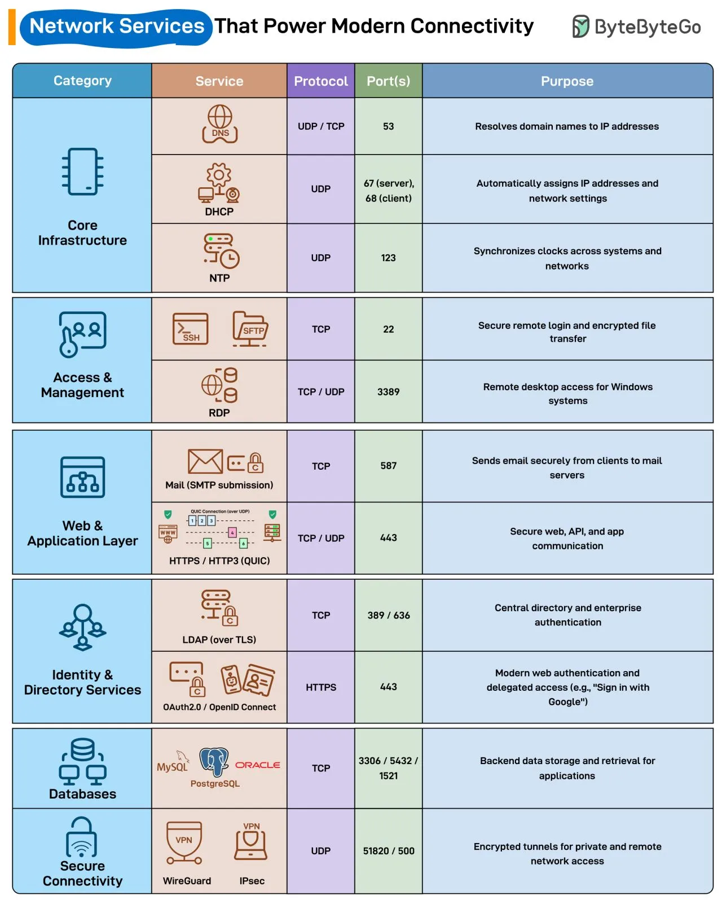

# 185 - Network Services That Power Modern Connectivity

- Source: ByteByteGo Big Archive System Design 2025
- PDF pages: 378-379
- Figures: 1

## Figures

## Original Extracted Text

Every time you open a browser, send an email, or connect to a VPN, these network services quietly
make it possible.

   ● DNS: Resolves domain names to IP addresses so users can reach websites without
      memorizing numbers.

   ● DHCP: Automatically assigns IPs and network settings to devices joining the network.

   ● NTP: Keeps clocks synchronized across systems to ensure consistent logs and
      authentication.

● SSH: Enables secure remote login and encrypted file transfers over port 22.

● RDP: Allows remote desktop access to Windows systems through port 3389.

● Mail (SMTP submission): Sends emails securely from clients to mail servers.

● HTTPS / HTTP3 (QUIC): Secures web, API, and app communication over encrypted
   channels.

● LDAP (over TLS): Acts as a central directory for enterprise logins and access control.

● OAuth2.0 / OpenID Connect: Powers modern authentication flows like "Sign in with Google."

● MySQL / PostgreSQL / Oracle: Handle backend data storage and retrieval for web and
   mobile applications.

● WireGuard / IPsec: Create encrypted tunnels for private and remote network access.
