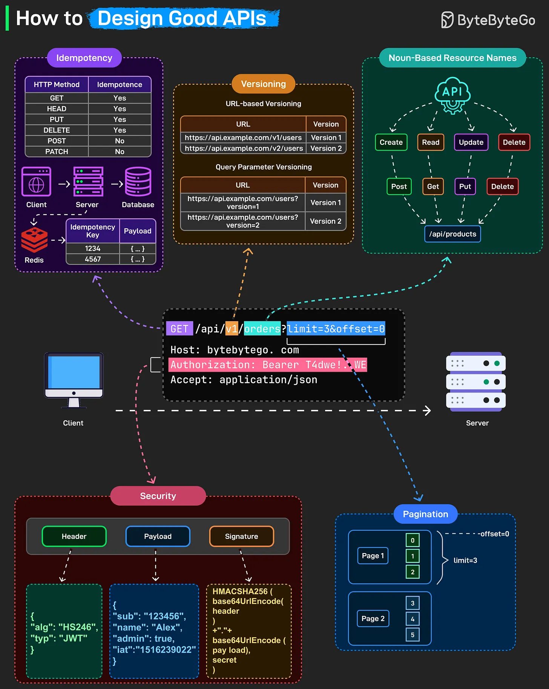

# 186 - How to Design Good APIs

- Source: ByteByteGo Big Archive System Design 2025
- PDF pages: 380-381
- Figures: 1

## Figures

## Original Extracted Text

A well-designed API feels invisible, it just works. Behind that simplicity lies a set of consistent design
principles that make APIs predictable, secure, and scalable.

Here's what separates good APIs from terrible ones:

    ● Idempotency: GET, HEAD, PUT, and DELETE should be idempotent. Send the same request
       twice, get the same result. No unintended side effects. POST and PATCH are not
       idempotent. Each call creates a new resource or modifies the state differently.

   Use idempotency keys stored in Redis or your database. Client sends the same key with
   retries, server recognizes it and returns the original response instead of processing again.

● Versioning

● Noun-based resource names: Resources should be nouns, not verbs. "/api/products", not
   "/api/getProducts".

● Security: Secure every endpoint with proper authentication. Bearer tokens (like JWTs)
   include a header, payload, and signature to validate requests. Always use HTTPS and verify
   tokens on every call.

● Pagination: When returning large datasets, use pagination parameters like
   "?limit=10&offset=20" to keep responses efficient and consistent.
