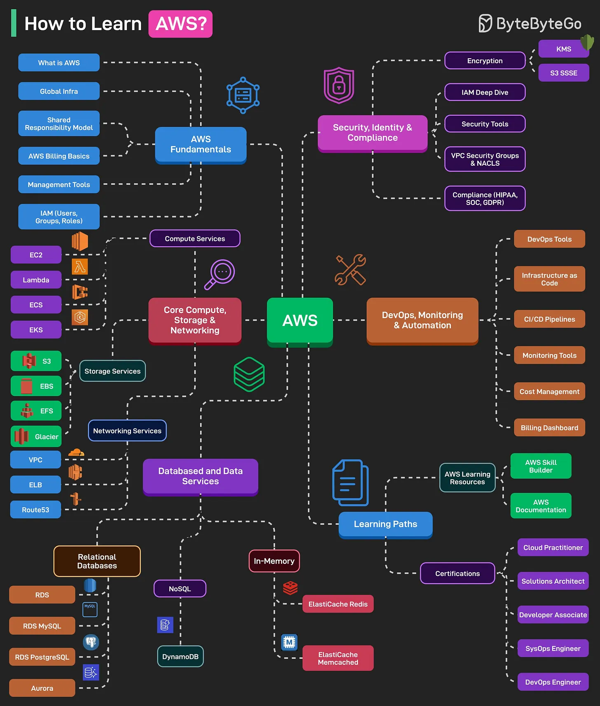

# 188 - How to Learn AWS?

- Source: ByteByteGo Big Archive System Design 2025
- PDF pages: 384-385
- Figures: 1

## Figures

## Original Extracted Text

AWS is one of the most popular cloud platforms. When AWS goes down, a large part of the Internet
goes down.

Here's a learning map that can help you master AWS:

   1. AWS Fundamentals
       This includes topics like "What is AWS?", Global Infrastructure, AWS Billing, Management,
       and IAM basics.

   2. Core Compute, Storage & Networking
       This includes compute services like EC2, Lambda, ECS, EKS, Storage Services (such as
       S3, EBS, EFS, Glacier), and Networking Services (such as VPC, ELB, Route 53).

3. Databases and Data Services
    This includes topics like Relational Databases (RDS MySQL and PostgreSQL), NoSQL, and
    In-Memory Databases like ElastiCache (Redis and Memcached).

4. Security, Identity & Compliance
    Consists of topics like IAM Deep Dive, Encryption (KMS, S3 SSE), Security Tools, VPC
    Security Groups, and Compliance-related tools for HIPAA, SOC, and GDPR.

5. DevOps, Monitoring & Automation
    This includes topics like DevOps Tools (CodeCommit, CodeBuild, CodePipeline),
    Infrastructure as Code, CI/CD Pipelines, Monitoring Tools (CloudWatch, CloudTrail), and
    Cost Management and Billing Dashboard

6. Learning Paths and Certifications
    Consists of topics like AWS Learning Resources, such as Skill Builder and documentation,
    and certification paths such as Cloud Practitioner, Solutions Architect Associate, Developer
    Associate, SysOps, and DevOps Engineer.
