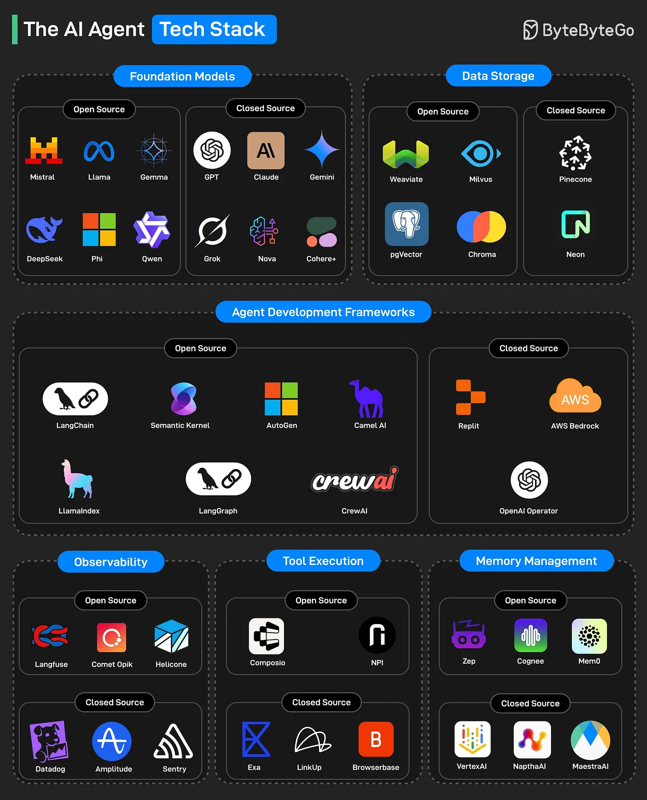

# 189 - The AI Agent Tech Stack

- Source: ByteByteGo Big Archive System Design 2025
- PDF pages: 386-387
- Figures: 1

## Figures

## Original Extracted Text

1. Foundation Models: Large-scale pre-trained language models that serve as the "brains" of AI
     agents, enabling capabilities like reasoning, text generation, coding, and question answering.

 2. Data Storage: This layer handles vector databases and memory storage systems used by AI
     agents to store and retrieve context, embeddings, or documents.

 3. Agent Development Frameworks: These frameworks help developers build, orchestrate, and
     manage multi-step AI agents and their workflows.

 4. Observability: This category enables monitoring, debugging, and logging of AI agent
     behavior and performance in real-time.

5. Tool Execution: These platforms allow AI agents to interface with real-world tools (for
    example, APIs, browsers, external systems) to complete complex tasks.

6. Memory Management: These systems manage long-term and short-term memory for agents,
    helping them retain useful context and learn from past interactions.
