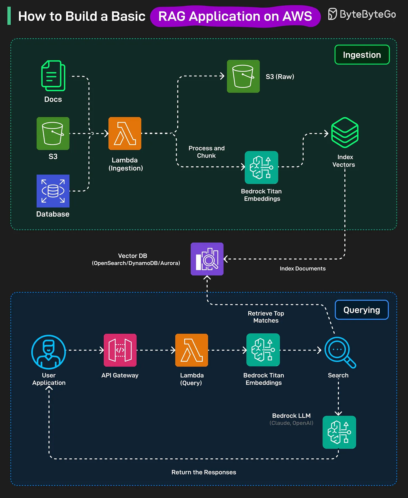

# 190 - How to Build a Basic RAG Application on AWS?

- Source: ByteByteGo Big Archive System Design 2025
- PDF pages: 388-389
- Figures: 1

## Figures

## Original Extracted Text

RAG is an AI pattern that combines a search step with text generation. It retrieves relevant
information from a knowledge source (like a vector database) and then uses an LLM to generate
accurate, context-aware responses.

Ingestion Stage

   1. All raw documents (PDFs, text, etc) are first stored in Amazon S3.

   2. When a file is added, AWS Lambda runs an ingestion function. This function cleans and
       splits the document into smaller chunks.

   3. Each chunk is sent to Amazon Bedrock's Titan embeddings model, which converts it into
       vector representations

   4. These embeddings, along with metadata, are stored in a vector database such as
       OpenSearch serverless, DynamoDB

Querying Stage:

   1. A user sends a question through the app frontend, which goes to API Gateway and then a
       Lambda query function.

   2. The question is converted to an embedding using Amazon Bedrock Titan Embeddings.

   3. This embedding is compared against the stored document embeddings in the vector
       database to find the most relevant chunks.

   4. The relevant chunks and the user's questions are sent to an LLM (like Claude or OpenAI on
       Bedrock) to generate an answer.

   5. The generated response is sent back to the user through the same API.
