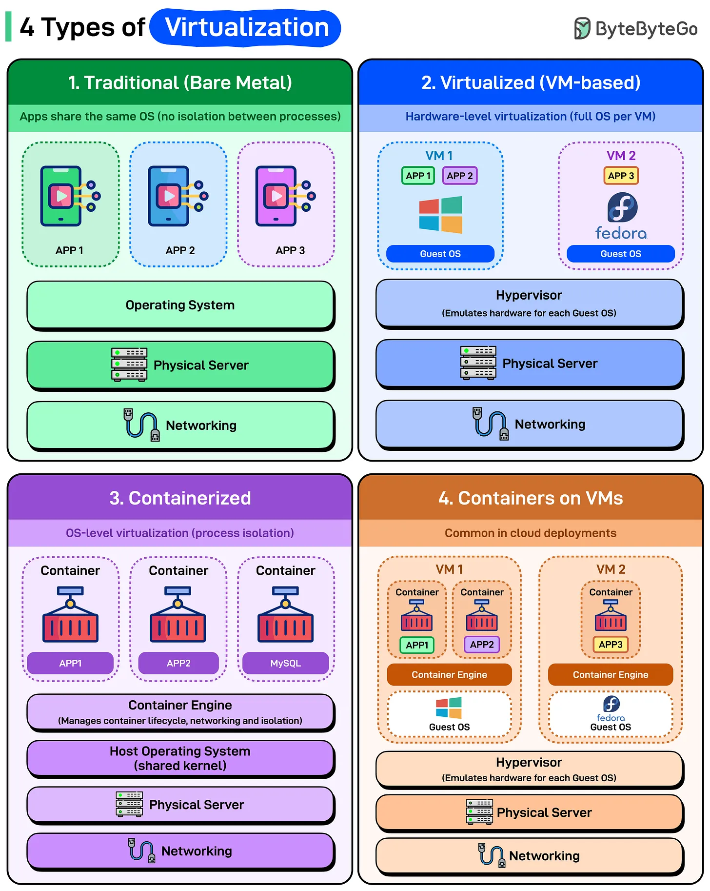

# 191 - Types of Virtualization

- Source: ByteByteGo Big Archive System Design 2025
- PDF pages: 390-391
- Figures: 1

## Figures

## Original Extracted Text

Virtualization didn't just make servers efficient, it changed how we build, scale, and deploy
everything. Here's a quick breakdown of the four major types of virtualization you'll find in modern
systems:

   1. Traditional (Bare Metal): Applications run directly on the operating system. No virtualization
       layer, no isolation between processes. All applications share the same OS kernel, libraries,
       and resources.

   2. Virtualized (VM-based): Each VM runs its own complete operating system. The hypervisor
       sits on physical hardware and emulates entire machines for each guest OS. Each VM thinks
       it has dedicated hardware even though it's sharing the same physical server.

   3. Containerized: Containers share the host operating system's kernel but get isolated runtime
       environments. Each container has its own filesystem, but they're all using the same
       underlying OS. The container engine (Docker, containerd, Podman) manages lifecycle,
       networking, and isolation without needing separate operating systems for each application.
       Lightweight and fast. Containers start in milliseconds because you're not booting an OS.
       Resource usage is dramatically lower than VMs.

   4. Containers on VMs: This is what actually runs in production cloud environments. Containers
       inside VMs, getting benefits from both. Each VM runs its own guest OS with a container
       engine inside. The hypervisor provides hardware-level isolation between VMs. The container
       engine provides lightweight application isolation within VMs.

This is the architecture behind Kubernetes clusters on AWS, Azure, and GCP. Your pods are
containers, but they're running inside VMs you never directly see or manage.
