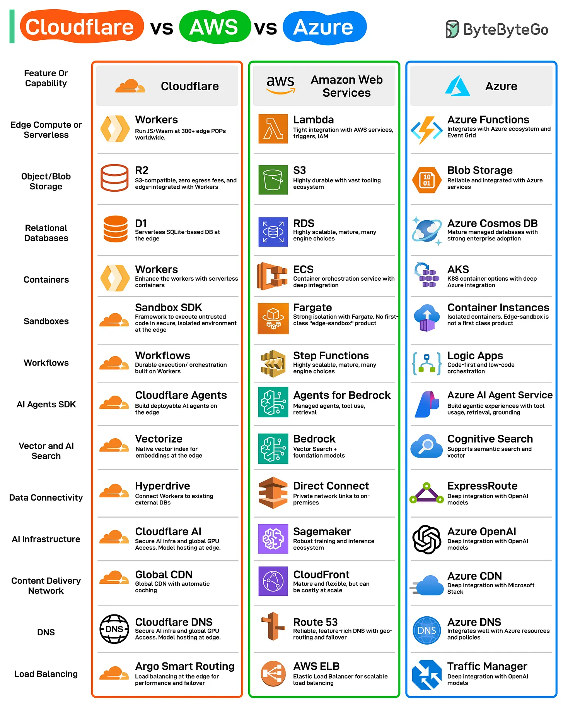

# 192 - Cloudflare vs. AWS vs. Azure

- Source: ByteByteGo Big Archive System Design 2025
- PDF pages: 392-393
- Figures: 1

## Figures

## Original Extracted Text

Cloudflare is much more than just a CDN and DDoS protection service. Let's do a quick comparison
of Cloudflare, AWS, and Azure.

Cloudflare has rapidly expanded beyond its traditional CDN roots, launching a suite of modern
developer-first services like Workers, R2, D1, and so on. These offerings position it as a serious
edge-native alternative to other cloud providers.

Here are the key cloud capabilities that Cloudflare supports:

   1. Edge Compute and Serverless

2. Object and Blob Storage

3. Relational Databases

4. Containers

5. Sandboxes

6. Workflows

7. AI Agents SDK

8. Vector and AI search

9. Data Connectivity

10.AI Infrastructure

11. Content Delivery Network

12.DNS

13.Load Balancing
