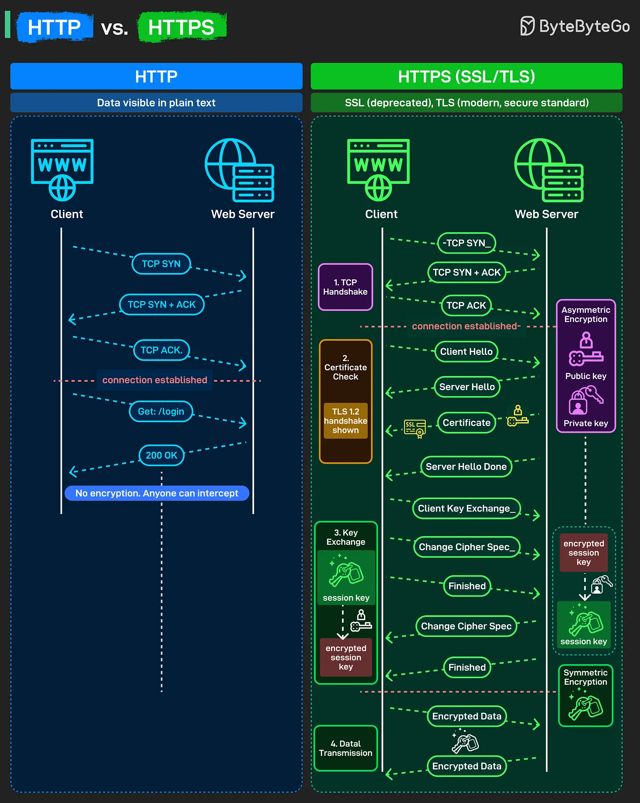

# 194 - HTTP vs. HTTPS

- Source: ByteByteGo Big Archive System Design 2025
- PDF pages: 395-396
- Figures: 1

## Figures

## Original Extracted Text

When you open a website, the difference between HTTP and HTTPS decides whether your data
travels safely or in plain sight. Here's what actually happens under the hood:

HTTP:

   ● Sends data in plain text, anyone on the network can intercept it.

   ● The client and server perform a simple TCP handshake: SYN, SYN-ACK, ACK

   ● Fast but completely insecure. Passwords, tokens, and forms can all be read in transit.

HTTPS (SSL/TLS):

   ● Step 1: TCP Handshake: Standard connection setup.

   ● Step 2: Certificate Check: Client says hello. Server responds with hello and its SSL/TLS
      certificate. That certificate contains the server's public key and is signed by a trusted
      Certificate Authority.
      Your browser verifies this certificate is legitimate, not expired, and actually belongs to the
      domain you're trying to reach. This proves you're talking to the real server, not some attacker
      pretending to be it.

   ● Step 3: Key Exchange: Here's where asymmetric encryption happens. The server has a
      public key and a private key. Client generates a session key, encrypts it with the server's
      public key, and sends it over. Only the server can decrypt this with its private key.
      Both sides now have the same session key that nobody else could have intercepted. This
      becomes the symmetric encryption key for the rest of the session.

   ● Step 4: Data Transmission: Now every request and response gets encrypted with that
      session key using symmetric encryption.
