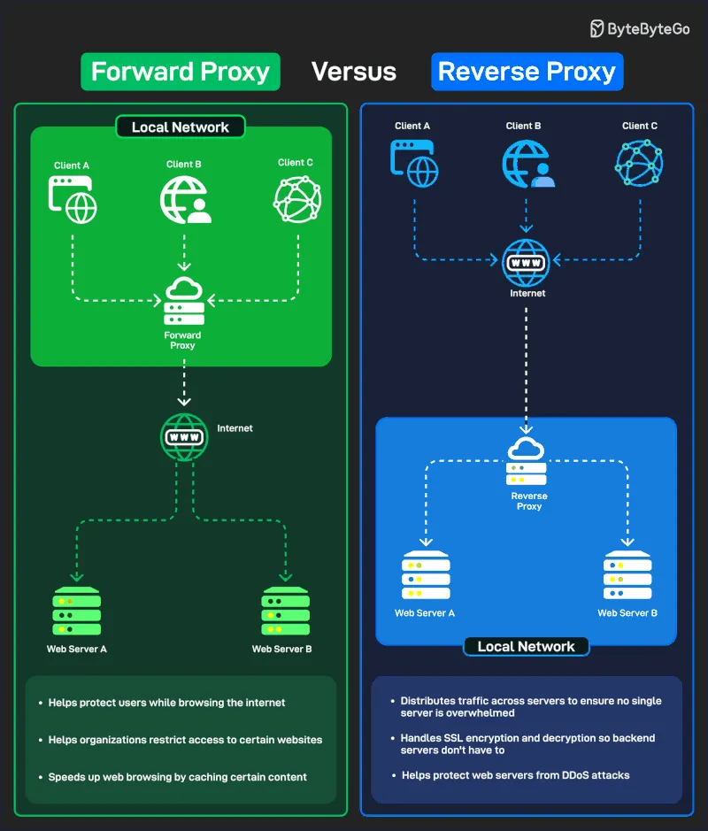

# 195 - Forward Proxy versus Reverse Proxy

- Source: ByteByteGo Big Archive System Design 2025
- PDF pages: 397-398
- Figures: 1

## Figures

## Original Extracted Text

A forward proxy sits between clients (users) and the internet. It acts on behalf of users, hiding their
identity or filtering traffic before it reaches the external web.

Some applications of a forward proxy are:

    1. Protect users while browsing the internet.

    2. Helps organizations restrict access to certain websites.

    3. Speeds up web browsing by caching frequently accessed content.

A reverse proxy sits between the internet (clients) and backend servers. It acts on behalf of servers,
handling incoming traffic.

Some applications of a reverse proxy are:

   1. Distributes traffic across multiple servers to ensure no single server is overwhelmed.

   2. Handles SSL encryption/decryption so backend servers don't have to.

   3. Helps protect backend servers from DDoS attacks.
