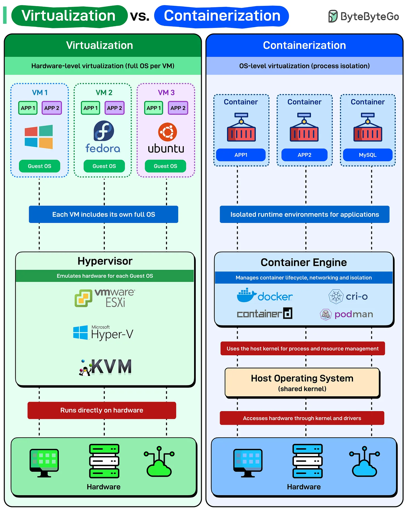

# 197 - Virtualization vs. Containerization

- Source: ByteByteGo Big Archive System Design 2025
- PDF pages: 401-402
- Figures: 1

## Figures

## Original Extracted Text

Before containers simplified deployment, virtualization changed how we used hardware. Both isolate
workloads, but they do it differently.

   ● Virtualization (Hardware-level isolation): Each virtual machine runs a complete operating
      system, Windows, Fedora, or Ubuntu, with its own kernel, drivers, and libraries. The
      hypervisor (VMware ESXi, Hyper-V, KVM) sits directly on hardware and emulates physical
      machines for each guest OS.
      This makes VMs heavy but isolated. Need Windows and Linux on the same box? VMs
      handle it easily. Startup time for a typical VM is in minutes because you're booting an entire
      operating system from scratch.

● Containerization (OS-level isolation): Containers share the host operating system's kernel.
   No separate OS per container. Just isolated processes with their own filesystem and
   dependencies.
   The container engine (Docker, containerd, CRI-O, Podman) manages lifecycle, networking,
   and isolation, but it all runs on top of a single shared kernel. Lightweight and fast. Containers
   start in milliseconds because you're not booting an OS, just launching a process.
   But here's the catch: all containers on a host must be compatible with that host's kernel.
   Can't run Windows containers on a Linux host (without nested virtualization tricks).
