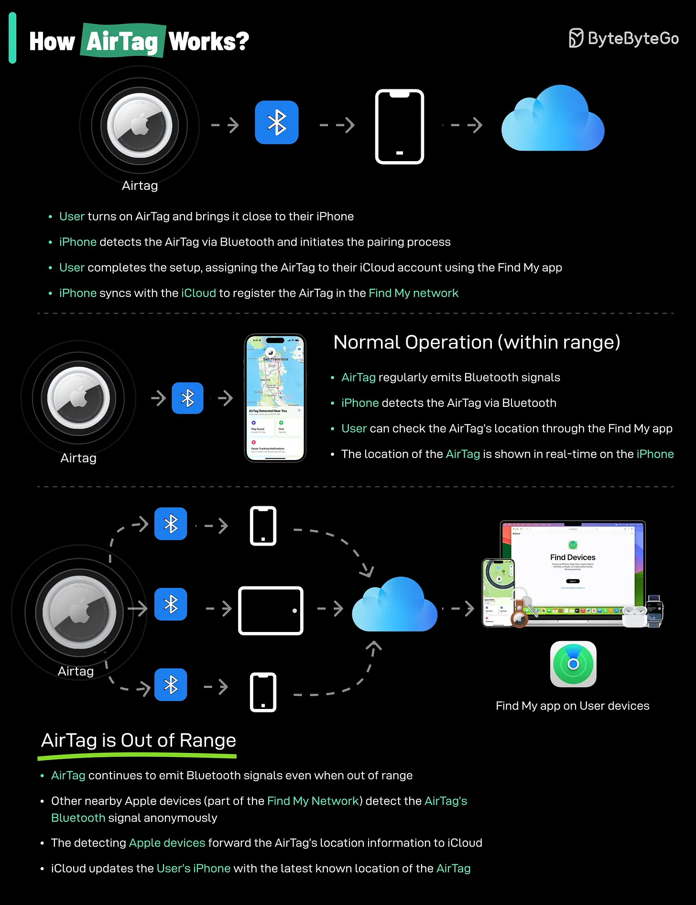

# 199 - How do AirTags work?

- Source: ByteByteGo Big Archive System Design 2025
- PDF pages: 405-406
- Figures: 1

## Figures

## Original Extracted Text

AirTags work by leveraging a combination of Bluetooth technology and the vast network of Apple
devices to help you locate your lost items.
Here's a breakdown of how they function:

   1. Bluetooth Signal: Each AirTag emits a secure Bluetooth signal that can be detected by
       nearby Apple devices (iPhones, iPads, etc.) within the Find My network.

   2. Find My Network: When an AirTag comes within range of an Apple device in the Find My
       network, that device anonymously and securely relays the AirTag's location information to
       iCloud.

   3. Location Tracking: You can then use the Find My app on your own Apple device to see the
       approximate location of your AirTag on a map.

Limitations:
Please note that AirTags rely on Bluetooth technology and the presence of Apple devices within the
Find My network. If your AirTag is in an area with few Apple devices, its location may not be updated
as frequently or accurately.
