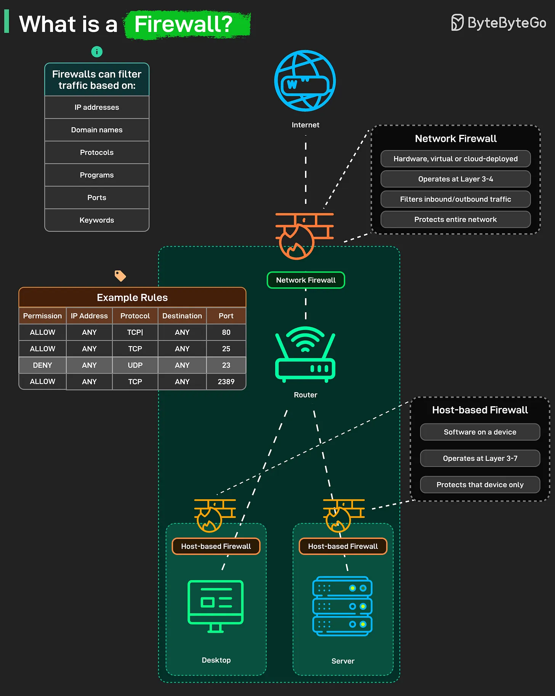

# 200 - What is a Firewall?

- Source: ByteByteGo Big Archive System Design 2025
- PDF pages: 407-408
- Figures: 1

## Figures

## Original Extracted Text

Every time you connect to the Internet, a firewall quietly decides what can come in and what must
stay out. A firewall is your network's first line of defense. It filters traffic based on rules you define, by
IP address, protocol, port, program, or even keywords. Every packet that tries to enter or leave your
network passes through this checkpoint.

There are two main types:

    1. Network Firewall: Sits at the network edge between your infrastructure and the internet. Can
        be physical hardware, virtualized software, or cloud-deployed service. Operates at Layer 3-4

   of the OSI model. Filters traffic based on IP addresses, protocols, and ports before it ever
   reaches your internal network.

   Protects the entire network at once. This is your first line of defense. Internet traffic hits the
   network firewall before it reaches your router, before it touches any internal systems.

2. Host-based Firewall: This runs as software on individual devices, like your laptop or a server.
    It works at Layer 3-7, inspecting packets more deeply and protecting only that specific
    device.

    Your desktop has its own host firewall. Your server has its own. Each one is configured
    independently. It's your last layer of defense in case something slips past the network
    firewall.

    Together, they form a layered shield, keeping unwanted traffic out while letting legitimate
    communication flow freely.
