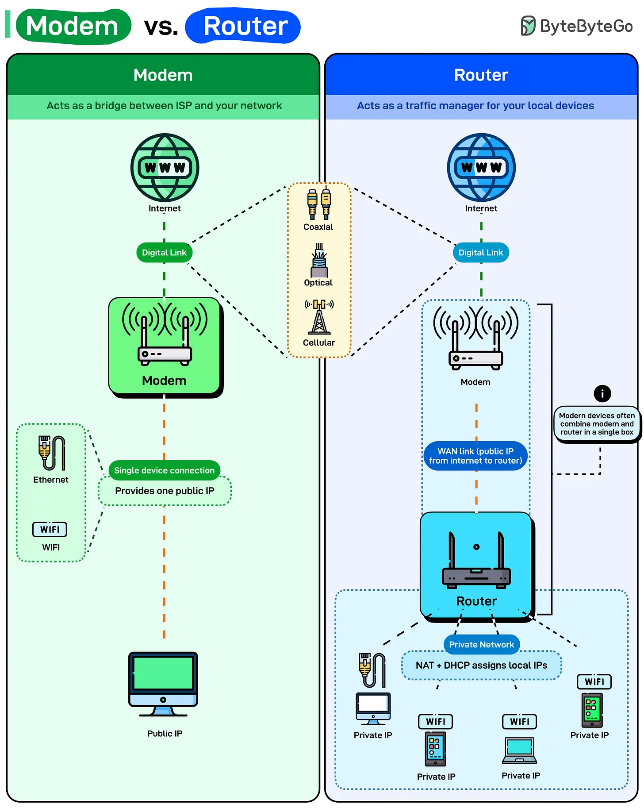

# 201 - Modem vs. Router

- Source: ByteByteGo Big Archive System Design 2025
- PDF pages: 409-410
- Figures: 1

## Figures

## Original Extracted Text

Most people think their WiFi router gives them internet. It doesn't. Your router is just managing traffic
inside your home. The actual internet connection comes from the modem.

Here's what each one actually does:

    ● Modem: The modem connects you to your Internet Service Provider (ISP). It translates
       signals between your ISP's network and your home network. Depending on the service type,
       the digital link may use coaxial cable, fiber optic, or cellular connections. The modem
       converts those signals into data your devices can understand.

       It provides one public IP address, meaning one connection to the internet. If you plug a
       single device directly into a modem via Ethernet, that device gets internet access with a
       public IP.

   ● Router: The router creates a private network inside your home. It takes that single public IP
      from the modem and shares it across multiple devices using Network Address Translation
      (NAT). Every device on your network gets a private IP address, usually something like
      192.168.1.x. The router keeps track of which device requested what data and routes
      responses back to the right device.

      DHCP assigns those private IPs automatically. Your phone connects to WiFi, the router gives
      it an IP address, and suddenly it can talk to the internet through the router.

Modern devices often combine both functions, a modem-router combo, but understanding the
distinction helps when you're troubleshooting slow speeds or network drops.
