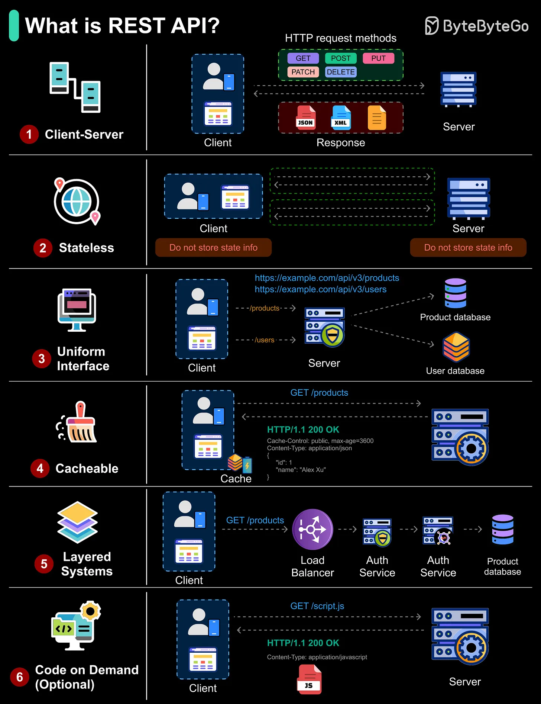

# 202 - What is a REST API?

- Source: ByteByteGo Big Archive System Design 2025
- PDF pages: 411-412
- Figures: 1

## Figures

## Original Extracted Text

REST (Representational State Transfer) is an architectural style for building APIs that use HTTP for
communication. To be considered RESTful, an API should follow six key constraints:

   ● Client-Server: Separates the user interface from data storage and processing. This allows
      each side to evolve independently.

   ● Stateless: Each request contains all the information needed to process it; the server does not
      store session state between requests.

● Uniform Interface: Consistent resource naming and formats across the API, e.g., "/products",
   "/users".

● Cacheable: Responses explicitly indicate if they can be cached (e.g., Cache-Control) to
   improve performance.

● Layered System: Requests may pass through multiple layers (load balancers, auth services,
   etc.) before reaching the API server, but to the client it appears as a single endpoint.

● Code on Demand (Optional): The server can send executable code (like JavaScript) to the
   client to extend its functionality.
