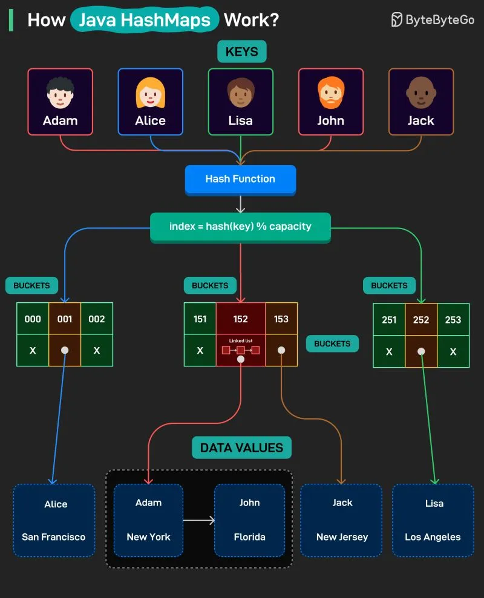

# 203 - How Java HashMaps Work?

- Source: ByteByteGo Big Archive System Design 2025
- PDF pages: 413-414
- Figures: 1

## Figures

## Original Extracted Text

A HashMap is a data structure that stores key-value pairs, allowing fast lookup, insertion, and
deletion. It uses a hash function to map each key to a bucket index, making access efficient.

Here's how it works:

   1. Keys are given to a HashMap

   2. A hash function converts each key into a number that points to a bucket index that points to
       the data value.

3. When two keys map to the same bucket index, a collision occurs.

4. Collisions are handled by linking entries together in a chain within the same bucket. This is
    done using a linked list or even trees in some cases.

5. Finally, values are retrieved quickly by hashing the key and looking up the correct bucket.
