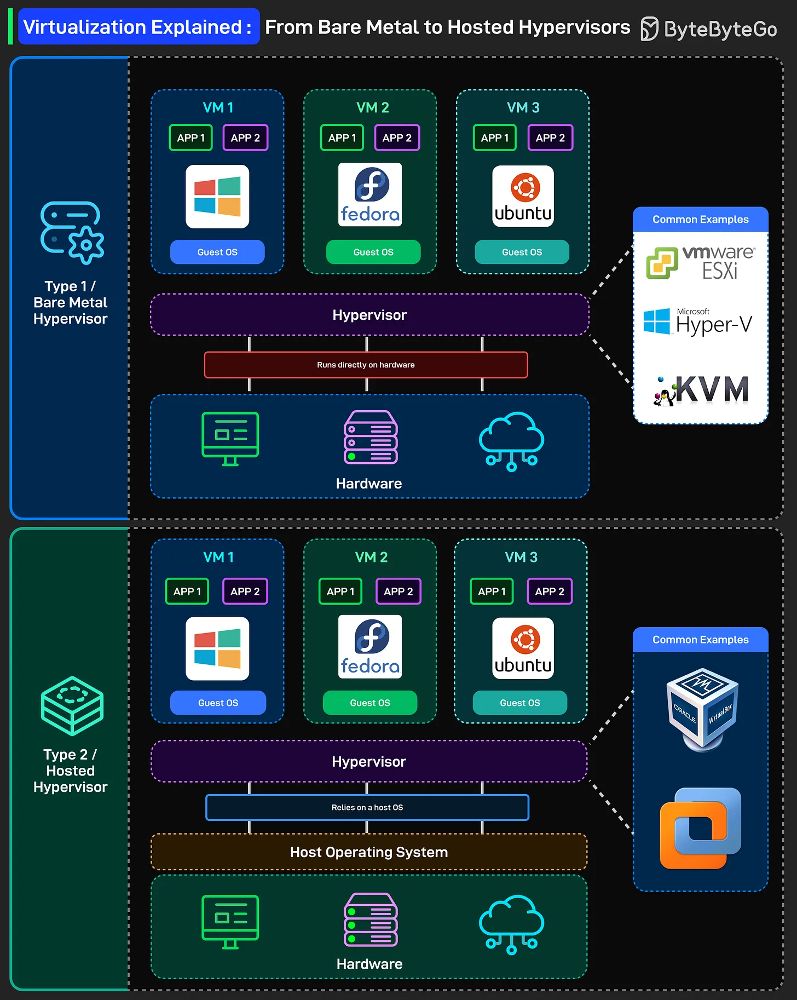

# 204 - Virtualization Explained: From Bare Metal to Hosted Hypervisors

- Source: ByteByteGo Big Archive System Design 2025
- PDF pages: 415-416
- Figures: 1

## Figures

## Original Extracted Text

Before containers and serverless, there was virtualization, the foundation of modern cloud
computing. Here's a simple breakdown of how virtualization works, from bare metal to hosted
hypervisors:

● Type 1 / Bare Metal Hypervisor: The hypervisor runs directly on hardware. No operating
   system underneath it. The hypervisor is the operating system layer. VMware ESXi, Microsoft
   Hyper-V, and KVM are all Type 1 hypervisors. They boot up on physical servers and manage
   VMs with direct hardware access.

   Each VM gets its own full operating system. Windows, Fedora, Ubuntu. Complete isolation
   between VMs. One crashes? The others keep running.

   This is what runs in data centers and cloud providers. When you spin up an EC2 instance on
   AWS, it's running on Type 1 virtualization (they use their custom Nitro hypervisor now, but
   same concept).

● Type 2 / Hosted Hypervisor: The hypervisor runs as an application on top of a host operating
   system. You're running Windows or macOS, then you install VirtualBox or VMware
   Workstation on top of it.

   Guest VMs still get full operating systems, but now there's an extra layer. Your VM talks to
   the hypervisor, which talks to the host OS, which talks to the hardware.

   More overhead, slightly lower performance, but way more convenient for development and
   testing. This is what you use on your laptop. Running a Linux VM on your MacBook? That's
   Type 2.
