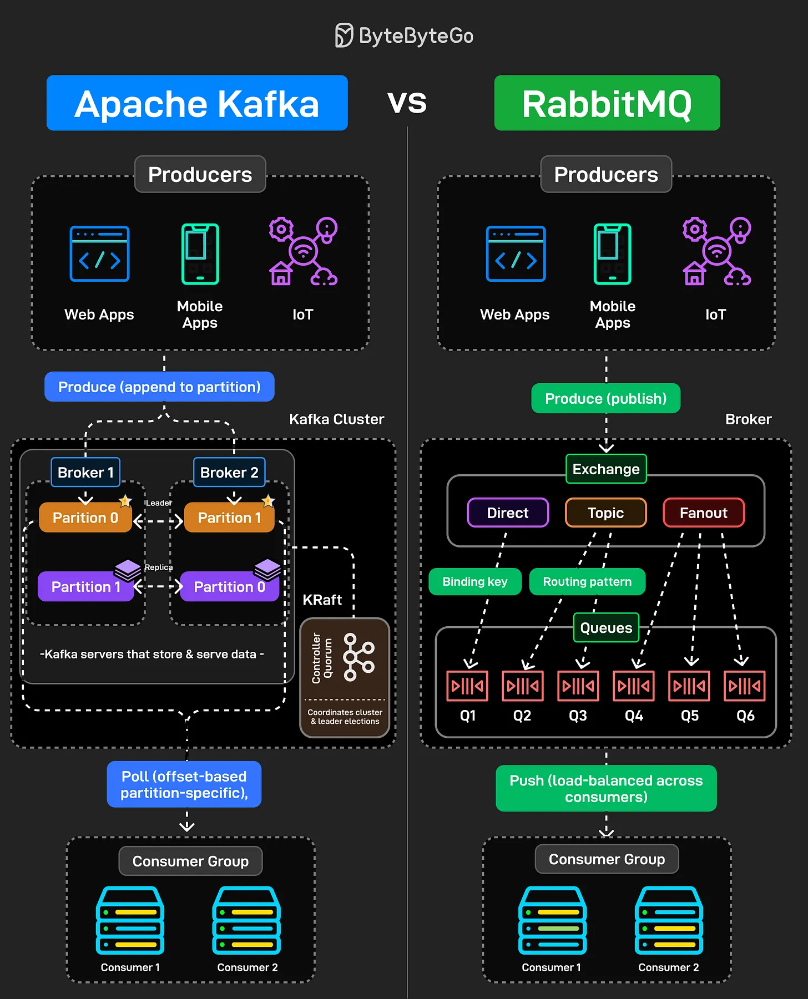

# 206 - Apache Kafka vs. RabbitMQ

- Source: ByteByteGo Big Archive System Design 2025
- PDF pages: 419-420
- Figures: 1

## Figures

## Original Extracted Text

Kafka and RabbitMQ both handle messages, but they solve fundamentally different problems.
Understanding the difference matters when designing distributed systems.

Kafka is a distributed log. Producers append messages to partitions. Those messages stick around
based on retention policy, not because someone consumed them. Consumers pull messages at their
own pace using offsets. You can rewind, replay, reprocess everything. It is designed for high
throughput event streaming where multiple consumers need the same data independently.

RabbitMQ is a message broker. Producers publish messages to exchanges. Those exchanges route
to queues based on binding keys and patterns (direct, topic, fanout). Messages get pushed to
consumers and then deleted once acknowledged. It is built for task distribution and traditional
messaging workflows.

The common mistake is using Kafka like a queue or RabbitMQ like an event log. They're different
tools built for different use cases.
