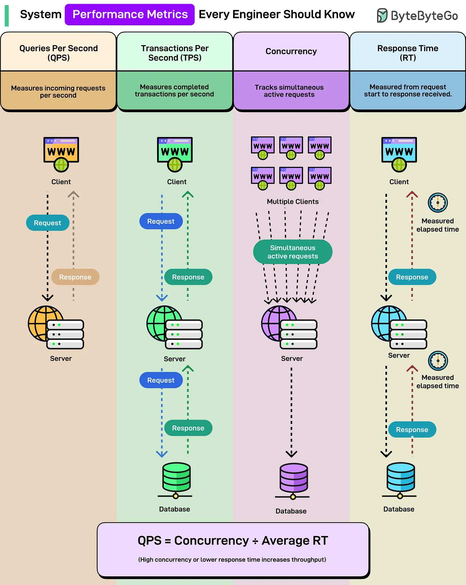

# 211 - System Performance Metrics Every Engineer Should Know

- Source: ByteByteGo Big Archive System Design 2025
- PDF pages: 429-430
- Figures: 1

## Figures

## Original Extracted Text

Your API is slow. But how slow, exactly? You need numbers. Real metrics that tell you what's
actually broken and where to fix it.

Here are the four core metrics every engineer should know when analyzing system performance:

   ● Queries Per Second (QPS): How many incoming requests your system handles per second.
      Your server gets 1,000 requests in one second? That's 1,000 QPS. Sounds straightforward

   until you realize most systems can't sustain their peak QPS for long without things starting to
   break.

● Transactions Per Second (TPS): How many completed transactions your system processes
   per second. A transaction includes the full round trip, i.e., the request goes out, hits the
   database, and comes back with a response.
   TPS tells you about actual work completed, not just requests received. This is what your
   business cares about.

● Concurrency: How many simultaneous active requests your system is handling at any given
   moment. You could have 100 requests per second, but if each takes 5 seconds to complete,
   you're actually handling 500 concurrent requests at once.
   High concurrency means you need more resources, better connection pooling, and smarter
   thread management.

● Response Time (RT): The elapsed time from when a request starts until the response is
   received. Measured at both the client level and server level.
   A simple relationship ties them all together: QPS = Concurrency ÷ Average Response Time
   More concurrency or lower response time = higher throughput.
