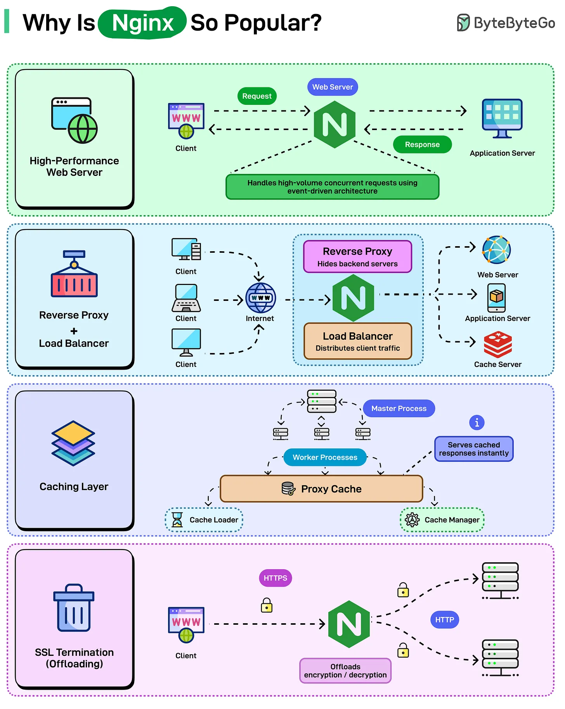

# 212 - Why Is Nginx So Popular?

- Source: ByteByteGo Big Archive System Design 2025
- PDF pages: 431-432
- Figures: 1

## Figures

## Original Extracted Text

Apache dominated web servers for 20 years, then Nginx showed up and changed everything. Now
Nginx powers some of the largest sites on the internet, including Netflix, Airbnb, Dropbox, and
WordPress. com. Not because it's newer or trendier, but because it solves problems that Apache
couldn't handle efficiently.

Here's what makes Nginx so popular:

   ● High-Performance Web Server

● Reverse Proxy & Load Balancer

● Caching Layer

● SSL Termination (Offloading)
